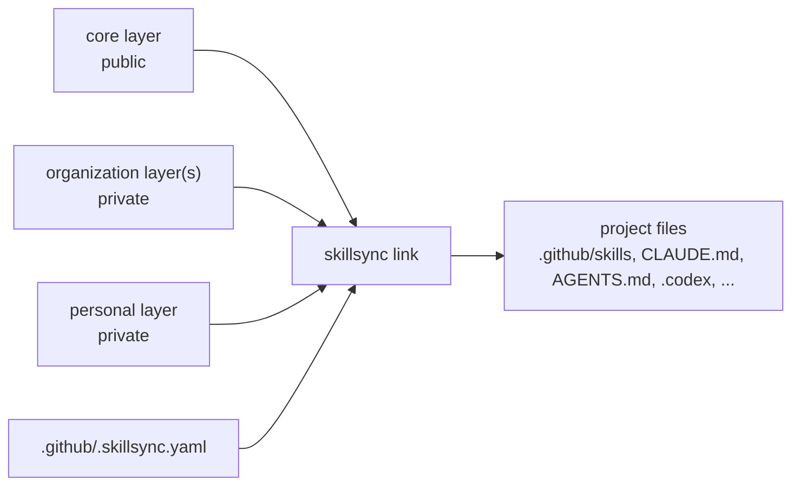

**English** · [Polski](README.pl.md)

# Skillsync

[](https://github.com/BATUSystems/skillsync/actions/workflows/ci.yml)
[](https://github.com/BATUSystems/skillsync/releases)
[](LICENSE)

Skillsync is a generator of files for AI coding agents. It builds the instructions, skills and roles of
**GitHub Copilot, Claude Code, Codex and Cursor** from layers of skills and instructions (core, organization and personal)
and writes them into your projects. It also ships an agent workflow (spec → plan → delivery) with checks, checkpoints and independent review.

Supported hosts and the artifacts generated for them:

| Host | Generated artifacts |
|---|---|
| GitHub Copilot | `.github/copilot-instructions.md`, `.github/skills/` |
| Claude Code | `CLAUDE.md` (imports `@AGENTS.md` in the `agents` mode), `.claude/skills/`, `.claude/agents/`, `.claude/hooks/`, `.claude/settings.json`, `.claude/settings.local.json` |
| Codex | `AGENTS.md`, `.codex/config.toml`, `.codex/agents/`, `.codex/skillsync-instructions.md`, `.agents/skills/` |
| Cursor | `.cursor/rules/` (`base.mdc`, `project.mdc`, `<skill>.mdc`) |

The generator keeps its state in `.github/.skillsync-state.json`.

## Why

- **One source, many projects.** Edit a skill once; every linked project gets it.
- **Layers.** A public *core*, one or more *organization* layers and your own *personal* layer are composed on your machine. Projects never decide which organization they belong to; your machine config does.
- **Isolation by design.** Content of one organization never reaches another organization's repository; `leakcheck` guards commits and pushes.
- **Agent workflow included.** Acts I–III (Spec, Plan, Delivery), scoped roles, test selection, checkpoints and resume.

## Who it is for

- **Developers** who work with AI agents in several repositories and want the same skills and instructions in each of them.
- **Organizations** that share conventions and tooling with their teams in a private layer, without publishing them.
- **Layer authors** who create an organization or personal layer: [docs/layers-authoring.md](docs/layers-authoring.md).
- **Contributors** to the public core: [CONTRIBUTING.md](CONTRIBUTING.md).

## How it works



## Concepts

**Layers.** A layer is a git repository with skills (`skills/`), instructions (`instructions/`), agent roles
(`agents/`) and workflow settings (`workflow/`), described by a `layer.yaml` with its own version.

| Layer | Who maintains it | What it holds |
|---|---|---|
| `core` | this repository, public | generic skills, the agent workflow, roles, shared instructions |
| organization | each organization, private | conventions, domain knowledge and tooling of one organization |
| personal | you, private | your habits, an optional agent persona and card names, your own tools |

Your machine config lists the layers and decides, by the real path of each project, which layers apply to it.
A project's manifest (`.github/.skillsync.yaml`) chooses skills and settings but never another organization's layer.
When several layers provide the same file, the later layer wins; some aggregate files are merged.

**Isolation.** A machine can be restricted to the layers it is allowed to hold (`skillsync layers check --isolation`).
`skillsync leakcheck` and local git hooks block names, paths and commit identities that do not belong in the
target repository. See [docs/security.md](docs/security.md).

**Agent workflow.** The `feature` skill runs a change in three acts, with an independent review loop at the end of each:

| Act | Result | Approval at the end |
|---|---|---|
| I. Spec | a spec without open questions and a draft plan | “GO plan” |
| II. Plan | steps, tests, resources and the proposed version | “GO implement” |
| III. Delivery | code, tests, review, documentation, changelog, version | status `done`; commits and pushes follow the delivery mode (`delivery.mode`) |

The main session orchestrates; scoped subagents (explore, implementer, test-writer, test-runner, reviewer, verifier,
scribe, mechanic) do the work and never delegate further. Small bugs use the shorter `bugfix` flow. Larger goals can
be split by `dispatch` into packages, each delivered by a separate session (a *card*, aliased `karta-1`, `karta-2`…).
Details: [docs/workflow.md](docs/workflow.md).

**Prototypes.** With your consent, the agent can build a clickable HTML mock-up of a UI flow inside the repository
(`docs/prototypes/<slug>/`). `skillsync prototype` creates prototypes, serves them with shared comments and runs their
acceptance. `skillsync prototype login-link` issues a one-time login link for the running server (a human command). See [docs/prototypes.md](docs/prototypes.md).

**Dashboard.** `skillsync dashboard show` prints the project status (plans, steps, checkpoints, approvals) as JSON,
`skillsync dashboard serve` shows the same state as a live page and `skillsync dashboard metrics` computes run metrics.
`skillsync approvals record` writes the user's consent (`GO plan`, `GO implement`, `CP`, `READY`). A `status-board` entry in the manifest `skills:` list expands to `dashboard` when no layer provides its own `status-board`. The manifest key `workflow.ceremony` (`full` | `demo`) sets how much process ceremony the agent applies ([docs/manifest.md](docs/manifest.md)). The JSON contract: [docs/dashboard-contract.md](docs/dashboard-contract.md).

## Requirements

- Python 3.11 or newer. PyYAML is installed together with the package.
- git. Layers are cloned and checked out with git.
- [uv](https://docs.astral.sh/uv/), used to install the tool.

Developed and tested with uv 0.13; the minimum version has not been measured. CI uses the current uv.

Supported systems: v1.1.x supports Linux, WSL2 and macOS (CI on Ubuntu and macOS blocks the release). The installer (`install.sh`) covers the same systems; native Windows is outside the installer path (use WSL2), CI runs it, but its result does not block the release.

| System | Support in v1.1.x | Known limits |
|---|---|---|
| Linux | Full (planned) | none planned |
| macOS | Everything except the watch service as a system service (planned for v1.1.0) | no watch service as a system service |
| Windows | Copy mode by default (symlinks only with Developer Mode); CLI, `link`, `doctor` and workflow commands (planned) | no watch service, no `flock`, no TTY |

The table rests on CI results (tests, install smoke). Manual tests on macOS and Windows are planned for a later release; native Windows is outside the installer path (use WSL2).

## Install

```bash
uv tool install git+https://github.com/BATUSystems/skillsync@v1.1.0
```

Check the installation:

```bash
skillsync --version
```

`skillsync --version` prints the generator version (`skillsync_workflow.__version__`).

`skillsync-ctl` (the `systemctl --user` wrapper for the watch service) is not part of the installed package: the package holds only
`skillsync_workflow` with the `skillsync` entry point. The script works only on Linux, from a repository checkout.

Update, uninstall and troubleshooting: [docs/installation.md](docs/installation.md).

## Quick start

Fast path (Linux, WSL2 or macOS): one command installs the tool and runs `skillsync setup`, which adds the core layer,
an optional organization layer, the layer rule and a final check. Read the script before you run it; options and
troubleshooting are in [docs/installation.md](docs/installation.md#szybka-instalacja-linux-wsl2-macos) (Polish).

```bash
curl --proto '=https' --tlsv1.2 -LsSf https://raw.githubusercontent.com/BATUSystems/skillsync/<tag>/install.sh | sh
```

Replace `<tag>` with a release tag (for example `v1.1.0`). Native Windows is not supported by the installer: use WSL2.
The steps below do the same by hand.

This path needs no organization layer: a personal layer and the core layer are enough.

Run the steps in this order: a rule created by `layers use` includes `core` only when `core` is already registered.

Step 6 needs an existing project directory (a git repository) with a minimal manifest `~/Repos/Acme/shop/.github/.skillsync.yaml` (keys: [docs/manifest.md](docs/manifest.md)):

```yaml
version: 1
project: {name: Acme/shop, type: local}   # matches the project path, otherwise every command warns
skills: [feature]
instructions: {merge: [_base]}            # add `template: <name>` (instructions/<name>.md in a layer) to get .github/copilot-instructions.md
sync: {method: symlink}
```

```bash
# 1. Add the core layer (skills, workflow and roles); it is part of every rule
skillsync layers add core --kind core --source https://github.com/BATUSystems/skillsync --subdir library --ref v1.1.0

# 2. Create the skeleton of your personal layer (a git repository) and commit it:
#    `layers add` clones the repository, so the skeleton must be committed first
skillsync layers init ~/Repos/my-skillsync --kind personal --id my
git -C ~/Repos/my-skillsync add -A
git -C ~/Repos/my-skillsync commit -m "Layer skeleton"

# 3. Register the personal layer and use it for all directories
#    (`layers add` does not create the default rule `**`)
skillsync layers add my --kind personal --source ~/Repos/my-skillsync
skillsync layers use my --match '**'

# 4. Add an organization layer and select it for a directory (optional;
#    replace the example address with your organization's repository)
skillsync layers add acme --kind org --source git@github.com:acme/skillsync-acme.git
skillsync layers use acme --match '~/Repos/Acme/**'

# 5. Check the layers and what applies to the current directory
skillsync layers list
skillsync layers check

# 6. Link the project (with the manifest above)
cd ~/Repos/Acme/shop
skillsync link . --dry-run          # what would be written; nothing changes
skillsync link .                    # write the agent files into the project
skillsync doctor .                  # validate the project (exit 0 = PASS)
```

A directory that matches no `layer_rules` entry gets `BLOCKED` with the instruction to run `skillsync layers use`.

**Existing machine.** A machine configured before layers moves to them with `layers migrate` (replace `<…>` with the path):

```bash
skillsync layers migrate --layer-source core=<local clone of the skillsync repository>/library           # dry-run: writes nothing
skillsync layers migrate --layer-source core=<local clone of the skillsync repository>/library --apply   # writes the new config and keeps a backup copy
```

Organization and personal layers, manifests, finishing and rollback: [docs/upgrading.md](docs/upgrading.md).

## Documentation

Documentation (`docs/`) is in Polish for now; English pages will follow. The index of all files is in [docs/README.md](docs/README.md).

| I want to… | Read |
|---|---|
| install, update, uninstall (Linux, macOS, Windows) | [installation](docs/installation.md) |
| configure layers and my machine | [configuration](docs/configuration.md) |
| configure a project | [manifest](docs/manifest.md) |
| look up a command | [cli](docs/cli.md) |
| use the agent workflow | [workflow](docs/workflow.md) |
| build clickable HTML prototypes | [prototypes](docs/prototypes.md) |
| create my own organization or personal layer | [layers-authoring](docs/layers-authoring.md), [example](docs/examples/personal-layer/) |
| understand isolation and `leakcheck` | [security](docs/security.md) |
| upgrade between versions | [upgrading](docs/upgrading.md) |
| understand the architecture | [architecture](docs/architecture.md) |
| contribute | [CONTRIBUTING](CONTRIBUTING.md), [development](docs/development.md) |

## Related

- [Skippster](https://github.com/BATUSystems/skippster): VS Code extension that shows agent sessions, plans, approvals and prototypes on top of Skillsync.

## Versioning, security, license

- [Semantic Versioning](https://semver.org/); see [CHANGELOG](CHANGELOG.md) and [upgrading](docs/upgrading.md).
- Report vulnerabilities as described in [SECURITY](SECURITY.md).
- [MIT](LICENSE) © BATUSystems.
