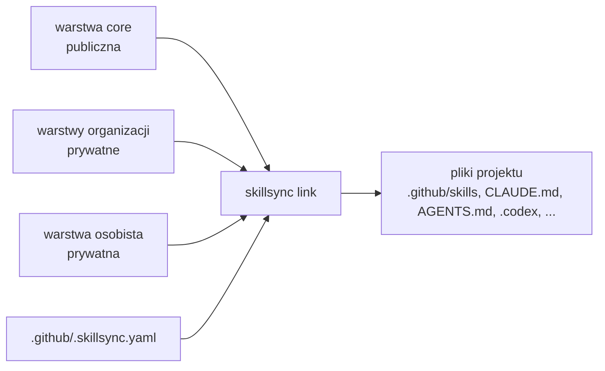

[English](README.md) · **Polski**

# Skillsync

[](https://github.com/BATUSystems/skillsync/actions/workflows/ci.yml)
[](https://github.com/BATUSystems/skillsync/releases)
[](LICENSE)

Skillsync to generator plików dla agentów AI do kodowania. Buduje instrukcje, skille i role dla
**GitHub Copilot, Claude Code, Codexa i Cursora** z warstw skilli i instrukcji (rdzeń, organizacja i warstwa osobista)
i zapisuje je w Twoich projektach. Dostarcza też agent flow (spec → plan → realizacja) z kontrolami, checkpointami i niezależnym review.

Obsługiwane hosty i artefakty generowane dla nich:

| Host | Generowane artefakty |
|---|---|
| GitHub Copilot | `.github/copilot-instructions.md`, `.github/skills/` |
| Claude Code | `CLAUDE.md` (importuje `@AGENTS.md` w trybie `agents`), `.claude/skills/`, `.claude/agents/`, `.claude/hooks/`, `.claude/settings.json`, `.claude/settings.local.json` |
| Codex | `AGENTS.md`, `.codex/config.toml`, `.codex/agents/`, `.codex/skillsync-instructions.md`, `.agents/skills/` |
| Cursor | `.cursor/rules/` (`base.mdc`, `project.mdc`, `<skill>.mdc`) |

Generator zapisuje swój stan w `.github/.skillsync-state.json`.

## Po co

- **Jedno źródło, wiele projektów.** Poprawiasz skill raz, dostają go wszystkie podlinkowane projekty.
- **Warstwy.** Publiczny *rdzeń*, jedna lub kilka warstw *organizacji* i Twoja warstwa *osobista* składają się na Twojej maszynie. O organizacji projektu decyduje konfiguracja maszyny, nie repo projektu.
- **Izolacja od początku.** Treść jednej organizacji nie trafia do repo innej; `leakcheck` pilnuje commitów i pushy.
- **Agent flow w zestawie.** Akty I–III (Spec, Plan, Realizacja), role o wąskim zakresie, dobór testów, checkpointy i wznowienie.

## Dla kogo

- **Programiści**, którzy pracują z agentami AI w kilku repozytoriach i chcą mieć te same skille i instrukcje w każdym z nich.
- **Organizacje**, które dzielą konwencje i narzędzia z zespołami w prywatnej warstwie, bez publikowania ich.
- **Autorzy warstw**, którzy tworzą warstwę organizacji lub osobistą: [docs/layers-authoring.md](docs/layers-authoring.md).
- **Współtwórcy** publicznego rdzenia: [CONTRIBUTING.md](CONTRIBUTING.md).

## Jak to działa



## Pojęcia

**Warstwy.** Warstwa to repo git ze skillami (`skills/`), instrukcjami (`instructions/`), rolami agentów (`agents/`)
i ustawieniami workflow (`workflow/`), opisane plikiem `layer.yaml` z własną wersją.

| Warstwa | Kto utrzymuje | Co zawiera |
|---|---|---|
| `core` | to repo, publiczne | ogólne skille, agent flow, role, instrukcje wspólne |
| organizacji | każda organizacja, prywatne | konwencje, wiedza domenowa i narzędzia jednej organizacji |
| osobista | Ty, prywatne | Twoje nawyki, opcjonalna persona agenta i imiona kart, własne narzędzia |

Config maszyny wymienia warstwy i po rzeczywistej ścieżce projektu decyduje, które z nich go obejmują.
Manifest projektu (`.github/.skillsync.yaml`) wybiera skille i ustawienia, ale nigdy warstwy innej organizacji.
Gdy kilka warstw dostarcza ten sam plik, wygrywa późniejsza; część plików zbiorczych jest scalana.

**Izolacja.** Maszynę można ograniczyć do warstw, które wolno na niej trzymać (`skillsync layers check --isolation`).
`skillsync leakcheck` i lokalne hooki git blokują nazwy, ścieżki i tożsamości commitów, które nie należą do repo
docelowego. Zobacz [docs/security.md](docs/security.md).

**Agent flow.** Skill `feature` prowadzi zmianę w trzech aktach, a każdy kończy niezależna pętla przeglądu:

| Akt | Wynik | Zgoda na koniec |
|---|---|---|
| I. Spec | spec bez pytań otwartych i szkic planu | „GO plan” |
| II. Plan | kroki, testy, zasoby i propozycja wersji | „GO implement” |
| III. Realizacja | kod, testy, review, dokumentacja, changelog, wersja | status `done`; commity według trybu dostarczania (`delivery.mode`) |

Sesja główna jest orkiestratorem; pracę wykonują podagenci (podumysły) o wąskim zakresie (explore, implementer,
test-writer, test-runner, reviewer, verifier, scribe, mechanic), którzy nie delegują dalej. Małe błędy idą skróconym
flow `bugfix`. Większy cel `dispatch` dzieli na paczki, a każdą realizuje osobna sesja (*karta*, alias `karta-1`,
`karta-2`…). Szczegóły: [docs/workflow.md](docs/workflow.md).

**Prototypy.** Za Twoją zgodą agent buduje w repo klikalną makietę HTML przepływu UI (`docs/prototypes/<slug>/`).
`skillsync prototype` tworzy prototypy, udostępnia je ze wspólnymi komentarzami i prowadzi ich akceptację.
`skillsync prototype login-link` wystawia jednorazowy link logowania do działającego serwera (komenda człowieka). `skillsync prototype question` kieruje pytania domenowe do ekspertów na stronie `/_experts`. Zobacz [docs/prototypes.md](docs/prototypes.md).

**Dashboard.** `skillsync dashboard show` wypisuje stan projektu (plany, kroki, checkpointy, zgody) jako JSON,
`skillsync dashboard serve` pokazuje ten sam stan jako stronę z żywym odświeżaniem, a `skillsync dashboard metrics` liczy
metryki przebiegu. `skillsync approvals record` zapisuje zgodę użytkownika (`GO plan`, `GO implement`, `CP`, `READY`). Wpis `status-board` w `skills:` manifestu rozwija się do `dashboard`, gdy żadna warstwa nie dostarcza własnego `status-board`. Klucz manifestu `workflow.ceremony` (`full` | `demo`) ustala, ile ceremonii procesu stosuje agent ([docs/manifest.md](docs/manifest.md)). Kontrakt JSON: [docs/dashboard-contract.md](docs/dashboard-contract.md).

## Wymagania

- Python 3.11 lub nowszy. PyYAML instaluje się razem z pakietem.
- git. Warstwy są klonowane i przełączane przez git.
- [uv](https://docs.astral.sh/uv/), używany do instalacji narzędzia.

Rozwijane i sprawdzane z uv 0.13; minimalna wersja nie została zmierzona. CI używa bieżącego uv.

Obsługiwane systemy: v1.2.x wspiera Linux, WSL2 i macOS (CI na Ubuntu i macOS blokuje wydanie). Instalator (`install.sh`) obejmuje te same systemy; natywny Windows jest poza drogą instalatora (użyj WSL2), CI go uruchamia, ale jego wynik nie blokuje wydania.

| System | Wsparcie w v1.2.x | Znane ograniczenia |
|---|---|---|
| Linux | Pełne (planowane) | brak planowanych |
| macOS | Wszystko oprócz usługi watch jako usługi systemowej (planowane) | brak usługi watch jako usługi systemowej |
| Windows | Tryb kopii domyślnie (dowiązania tylko z Developer Mode); CLI, `link`, `doctor` i polecenia workflow (planowane) | brak usługi watch, `flock` i TTY |

Tabela opiera się na wynikach CI (testy, install smoke). Ręczne testy na macOS i Windows są zaplanowane na późniejsze wydanie; natywny Windows jest poza drogą instalatora (użyj WSL2).

## Instalacja

```bash
uv tool install git+https://github.com/BATUSystems/skillsync@v1.3.0
```

Sprawdź instalację:

```bash
skillsync --version
```

`skillsync --version` wypisuje wersję generatora (`skillsync_workflow.__version__`).

`skillsync-ctl` (wrapper `systemctl --user` dla usługi watch) nie jest częścią zainstalowanego pakietu: pakiet zawiera tylko
`skillsync_workflow` z punktem wejścia `skillsync`. Skrypt działa tylko na Linuksie, z checkoutu repo.

Aktualizacja, odinstalowanie i rozwiązywanie problemów: [docs/installation.md](docs/installation.md).

## Szybki start

Szybka ścieżka (Linux, WSL2 lub macOS): jedno polecenie instaluje narzędzie i uruchamia `skillsync setup`, który dodaje
warstwę core, opcjonalnie warstwę organizacji, regułę warstw i końcowe sprawdzenie. Przed uruchomieniem przeczytaj skrypt;
opcje i rozwiązywanie problemów: [docs/installation.md](docs/installation.md#szybka-instalacja-linux-wsl2-macos).

```bash
curl --proto '=https' --tlsv1.2 -LsSf https://raw.githubusercontent.com/BATUSystems/skillsync/<tag>/install.sh | sh
```

Zamiast `<tag>` podaj tag wydania (np. `v1.3.0`). Natywny Windows nie jest obsługiwany przez instalator: użyj WSL2.
Poniższe kroki robią to samo ręcznie.

Ta ścieżka nie wymaga warstwy organizacji: wystarczy warstwa osobista i warstwa core.

Wykonaj kroki w tej kolejności: reguła z `layers use` zawiera `core` tylko wtedy, gdy `core` jest już zarejestrowany.

Krok 6 wymaga istniejącego katalogu projektu (repo git) z minimalnym manifestem `~/Repos/Acme/shop/.github/.skillsync.yaml` (klucze: [docs/manifest.md](docs/manifest.md)):

```yaml
version: 1
project: {name: Acme/shop, type: local}   # zgodne ze ścieżką projektu, inaczej każde polecenie ostrzega
skills: [feature]
instructions: {merge: [_base]}            # `template: <nazwa>` (instructions/<nazwa>.md w warstwie) daje .github/copilot-instructions.md
sync: {method: symlink}
```

```bash
# 1. Dodaj warstwę core (skille, workflow i role); należy do każdej reguły
skillsync layers add core --kind core --source https://github.com/BATUSystems/skillsync --subdir library --ref v1.3.0

# 2. Utwórz szkielet własnej warstwy osobistej (repo git) i zacommituj go:
#    `layers add` klonuje repo, więc szkielet musi być najpierw w commicie
skillsync layers init ~/Repos/my-skillsync --kind personal --id my
git -C ~/Repos/my-skillsync add -A
git -C ~/Repos/my-skillsync commit -m "Szkielet warstwy"

# 3. Zarejestruj warstwę osobistą i użyj jej dla wszystkich katalogów
#    (`layers add` nie tworzy domyślnej reguły `**`)
skillsync layers add my --kind personal --source ~/Repos/my-skillsync
skillsync layers use my --match '**'

# 4. Dodaj warstwę organizacji i wybierz ją dla katalogu (opcjonalnie;
#    przykładowy adres zastąp repo swojej organizacji)
skillsync layers add acme --kind org --source git@github.com:acme/skillsync-acme.git
skillsync layers use acme --match '~/Repos/Acme/**'

# 5. Sprawdź warstwy i to, co obowiązuje w bieżącym katalogu
skillsync layers list
skillsync layers check

# 6. Podlinkuj projekt (z manifestem powyżej)
cd ~/Repos/Acme/shop
skillsync link . --dry-run          # co zostałoby zapisane; nic się nie zmienia
skillsync link .                    # zapis plików agentów w projekcie
skillsync doctor .                  # walidacja projektu (exit 0 = PASS)
```

Katalog, który nie pasuje do żadnego wpisu `layer_rules`, dostaje `BLOCKED` z instrukcją uruchomienia `skillsync layers use`.

**Istniejąca maszyna.** Maszyna skonfigurowana przed warstwami przechodzi na nie przez `layers migrate` (`<…>` zastąp ścieżką):

```bash
skillsync layers migrate --layer-source core=<lokalny klon repo skillsync>/library           # dry-run: nic nie zapisuje
skillsync layers migrate --layer-source core=<lokalny klon repo skillsync>/library --apply   # zapisuje nowy config i zostawia kopię zapasową
```

Warstwy organizacji i osobiste, manifesty, zakończenie i cofnięcie: [docs/upgrading.md](docs/upgrading.md).

## Dokumentacja

Dokumentacja (`docs/`) jest po polsku; strony po angielsku pojawią się później. Spis wszystkich plików: [docs/README.md](docs/README.md).

| Chcę… | Czytaj |
|---|---|
| zainstalować, zaktualizować, odinstalować (Linux, macOS, Windows) | [installation](docs/installation.md) |
| skonfigurować warstwy i maszynę | [configuration](docs/configuration.md) |
| skonfigurować projekt | [manifest](docs/manifest.md) |
| sprawdzić komendę | [cli](docs/cli.md) |
| pracować z agent flow | [workflow](docs/workflow.md) |
| zrobić klikalny prototyp HTML | [prototypes](docs/prototypes.md) |
| założyć własną warstwę organizacji lub osobistą | [layers-authoring](docs/layers-authoring.md), [przykład](docs/examples/personal-layer/) |
| zrozumieć izolację i `leakcheck` | [security](docs/security.md) |
| przejść na nowszą wersję | [upgrading](docs/upgrading.md) |
| poznać architekturę | [architecture](docs/architecture.md) |
| współtworzyć projekt | [CONTRIBUTING](CONTRIBUTING.md), [development](docs/development.md) |

## Powiązane

- [Skippster](https://github.com/BATUSystems/skippster): wtyczka VS Code pokazująca sesje agentów, plany, zgody i prototypy na bazie Skillsync.

## Wersje, bezpieczeństwo, licencja

- [Semantic Versioning](https://semver.org/lang/pl/); zob. [CHANGELOG](CHANGELOG.md) i [upgrading](docs/upgrading.md).
- Podatności zgłaszaj zgodnie z [SECURITY](SECURITY.md).
- [MIT](LICENSE) © BATUSystems.
