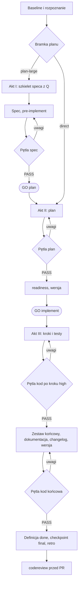

# Workflow: feature, dispatch, role i komendy kontrolne

Mapa agent flow: jak łączą się skille workflow (`feature`, `bugfix`, `dispatch` i ich towarzysze), role podagentów
(podumysłów) oraz komendy `skillsync`, które wspierają poszczególne akty. Czytaj, gdy trzeba wiedzieć, **która komenda wspiera
który akt** i co generator instaluje, żeby to działało. Treść procedur jest w skillach warstwy core
(`skills/...`, `agents/...`, `workflow/...`), tu tylko mapa i powiązania, bez duplikowania.

Pełna specyfikacja pracy orkiestratora i podagentów (kwalifikacja zadania, akty i zgody, spec, plan, pętla przeglądu,
kontrakt delegowania, zasoby, testy, wiedza, definicja `done`, `codereview`, `bugfix`, wejście z klucza, pomiar
i wiele sesji) jest w [workflow-details.md](workflow-details.md). Wersję HTML obu dokumentów do otwarcia
w przeglądarce buduje `python3 docs/site/build.py` do `docs/site/out/` (katalog poza gitem; opis w
[site/README.md](site/README.md)).

Stan opisu: Skillsync `v1.0.0`.

## Słownik

| Słowo | Znaczenie |
|---|---|
| **akt** | jedna z trzech części pracy `feature`: I Spec, II Plan, III Realizacja; między aktami są zgody |
| **faza**, **krok** | części planu (`### Faza 1`, krok `1.2`); krok ma rolę, `Exec` i ryzyko |
| **runda** | jedno okrążenie pętli przeglądu (świeży `reviewer`, jeden raport) |
| **etap** | etap pracy w projekcie (np. etap wdrożenia u klienta); nie część `feature` |
| **spec** | projekt jednej dużej zmiany w `docs/specs/`, zamrożony po wdrożeniu |
| **plan** | wykonanie zmiany w `docs/plans/` (kroki, testy, zasoby, wersja, Progress, Wynik) |
| **przebieg** | `run-id` z linii `Przebieg:` planu; pod nim zapisuje się checkpointy |
| **orkiestrator** | sesja główna: plan, zasoby, decyzje, rozmowa z użytkownikiem |
| **podagent** | rola wykonawcza uruchomiona przez orkiestratora; nie deleguje dalej |
| **karta**, **dyspozytor** | osobne sesje w trybie wielosesyjnym: karta robi jedną paczkę przez `feature`, dyspozytor koordynuje |

## Elementy i ich źródła

| Element | Gdzie żyje | Rola |
|---|---|---|
| `feature` (Claude `/feature`, Codex `$feature`) | `../library/skills/feature/` + `references/`: adaptery `claude.md`, `codex.md`; `spec.md`, `plan-large.md`, `plan-details.md`, `review-loop.md`, `review-material.md`, `tests-baseline.md`, `reports.md`, `resources.md`, `measurement.md`, `ticket-intake.md`, `frd-intake.md`, `pr-after-approval.md`, `worker-mode.md`, `multi-session.md`, `extensions.md` | akty I–III z pętlą przeglądu na końcu każdego; orkiestratorem jest sesja główna |
| `pre-implement` | `../library/skills/pre-implement/` + `../library/skills/workflow/references/contracts.md` | merytoryczna bramka przed zmianą kontraktu, API, danych albo wysokiego ryzyka; czyta spec, tylko do odczytu; `READY` / `NEEDS_CHANGES` / `BLOCKED` |
| `smart-test` | `../library/skills/smart-test/` | konserwatywny dobór testów z rzeczywistych zmian i zależności; plan nie jest dowodem wykonania |
| `bugfix` (Claude `/bugfix`, Codex `$bugfix`) | `../library/skills/bugfix/` (+ `../library/skills/bugfix/references/oracles.md`) | brief → test regresji czerwony na starym kodzie → poprawka → pętla `kod` → wiedza |
| `codereview` (Claude `/codereview`, Codex `$codereview`) | `../library/skills/codereview/` (+ `../library/skills/codereview/references/worktree.md`, `checklist.md`, `diff-signals.md`, `summary-template.md`) | niezależne review PR albo zmian przed PR w izolowanym worktree; tylko odczyt; obowiązkowa bramka walidacji; podsumowanie do wklejenia + rekomendacja |
| `dispatch` (Claude `/dispatch`, Codex `$dispatch`) | `../library/skills/dispatch/` + `references/`: `claude.md`, `codex.md`, `start-claims.md`, `loop.md`, `state.md`, `config.md`, `lessons.md`, `scenario.md` | dyspozytor równoległych sesji `feature` w jednym repo; bramka modelu Opus 5.5 lub Fable 5.1 w każdej turze |
| `pr-run` (`/pr-run`, `$pr-run`) | `../library/skills/pr-run/` (+ `../library/skills/pr-run/references/providers.md`, `templates.md`) | opcjonalny przebieg plan → draft PR → ready w Azure DevOps lub GitHub; tylko na jawne wywołanie |
| `prototype` | `../library/skills/prototype/` (profil `ui`) | opcjonalna klikalna makieta w `docs/prototypes/<slug>/` albo Artifact; tylko za zgodą użytkownika |
| Towarzysze | `workflow`, `pre-implement`, `smart-test`, `bugfix`, `codereview` | dołączani automatycznie razem z `feature` (`WORKFLOW_COMPANIONS` w `skillsync` i `skillsync_workflow/common.py`) |
| Skille profili | `workflow/skill-profiles.yaml` | `core`: `agent-runtime-pitfalls`; `testing`: `test-env`, `observed-e2e`; `workflow-extended`: `workflow-retro`, `task-claim`, `workflow-upgrade`, `skill-profiles`, `project-guard`, `dispatch`, `pr-run`, `ci-stabilize`, `tracker-workflow`; `ui`: `prototype` i skille dostępności; m.in. także `security`, `migration`, `infra`; wybór: `workflow.skill_profiles.selected` (domyślnie `core`, `testing`) |
| Role | `agents/*.md` + `codex.yaml` | podagenci; ten sam zestaw dla Claude i Codexa |
| Protokół wielu sesji | `../library/skills/feature/references/multi-session.md` | **jedyne** źródło protokołu (aliasy, gramatyka wiadomości, dzierżawy, PUSH SLOT, ID, raporty, wygaszanie) |
| Klucze przyczyn | `workflow/cause-keys.yaml` | krótka lista `--cause-key` z aliasami dla checkpointów i `retro` |
| Hook zamknięcia | `hooks/check-closure.py` | hook Stop: plan `done` bez rekordu `--final` przebiegu zatrzymuje turę (raz na sesję i plan) |
| Konfiguracja | `workflow/defaults.yaml` → `workflow/projects/<slug>.yaml` → `workflow:` w manifeście | routing, kontrole, budżety, reguły testów, profile: [manifest.md](manifest.md) |

Generator instaluje te skille, role i hook jak każde inne zasoby (`link`; [architecture.md](architecture.md)).
Reguły rozwijania skilli (towarzysze, profile) istnieją w dwóch miejscach generatora i pilnuje ich
`tests/test_skillsync_dispatch.py`.

## Role

| Rola | Claude (`agents/<Rola>.md`): model, effort, `omitClaudeMd`, narzędzia | Codex (`codex.yaml`) | Zakres |
|---|---|---|---|
| `explore` | `haiku`, low, `omitClaudeMd`, Read/Grep/Glob | `explorer`, `gpt-6-luna`, low, read-only | lokalizacja plików, wzorców i konsumentów |
| `implementer` | `sonnet`, medium, zapis + Bash | `implementer`, `gpt-6.1-sol`, medium, workspace-write | kod produkcyjny i przydzielona dokumentacja |
| `test-writer` | `sonnet`, medium, zapis + Bash | `test_writer`, `gpt-6.1-sol`, medium, workspace-write | testy (osobny autor przy większym ryzyku) |
| `test-runner` | `haiku`, low, `omitClaudeMd`, Read/Bash/Grep/Glob | `test_runner`, `gpt-6-luna`, low, workspace-write | uruchamianie przydzielonych kontroli |
| `reviewer` | `sonnet`, high, Read/Grep/Glob | `reviewer`, `gpt-6.1-sol`, high, read-only | niezależne review; profile pętli `spec`, `plan`, `kod` |
| `verifier` | `sonnet`, low, `omitClaudeMd`, Read/Grep/Glob | `verifier`, `gpt-6-luna`, low, read-only | punktowe twierdzenia `plik:linia` poza pętlą (`POTWIERDZONE` / `OBALONE` / `NIEROZSTRZYGNIĘTE`) |
| `scribe` | `haiku`, low, zapis bez Bash (Read/Write/Edit/Grep/Glob) | `scribe`, `gpt-6-luna`, low, workspace-write | dokumentacja, changelog, rekordy wiedzy |
| `mechanic` | `haiku`, low, `omitClaudeMd`, Read/Edit/Write/Grep/Glob/Bash | `mechanic`, `gpt-6-luna`, low, workspace-write | masowe, mechaniczne edycje według dokładnej mapy |

Modele i limity pochodzą z `agents/*.md` i `codex.yaml`; to konfiguracja warstwy core i może się zmienić
między wersjami. Podagenci nie delegują dalej; limit to 3 równoległe podagenty poza orkiestratorem (adaptery
`../library/skills/feature/references/claude.md` i `codex.md`). Do poprawek tego samego kroku wznawia się tego samego agenta,
ale **każda runda pętli przeglądu to nowy `reviewer`**. Model recenzenta w pętli: w Claude inny niż model sesji
(sesja na `sonnet` → `model: opus` w wywołaniu), w Codexie tylko przez `codex.agent_overrides`. Skład ról w projekcie:
`agents:` w manifeście (zawęża dla obu hostów); bez `agents:` projekt z `feature` dostaje wszystkie role z `codex.yaml`.

## Wybór flow

| Rodzaj pracy | Właściwy flow |
|---|---|
| pytanie, analiza, audyt | bez pipeline'u implementacyjnego |
| mały, jednoznaczny błąd | `bugfix` (brief i akt III) |
| wieloetapowa zmiana | `feature`; bramka planu: `plan-large` (akty I–III), `direct` (akty II–III), `reuse` (wznowienie istniejącego planu) |
| kontrakt / API / dane / migracja / uprawnienia / wysokie ryzyko | `feature` z `pre-implement` przed zapisem kodu |
| zadanie z kluczem zgłoszenia (`/feature ABC-1234`, `/bugfix SHOP-13341`) | odczyt zgłoszenia (`ticket-intake`), wariant `bugfix` albo `feature`, PR na „rób PR” |
| wymagania w pliku FRD (`docs/frd/`) | `frd-intake`: ocena `GOTOWY` / `LUKI` / `BLOKUJE`, mapa wymagań w specu |
| dostawa jako PR z postępem w planie | `/pr-run` (jawne wywołanie) |
| gotowe zmiany albo PR do niezależnego review | `codereview` |
| kilka pakietów realizowanych przez osobne sesje | `dispatch`; każda karta prowadzi własny `feature` |

Bramka planu (`feature`, krok 3): `plan-large` dla nowej zdolności, architektury, schematu, kontraktu API, wielu modułów
lub faz albo briefu z krytycznymi niewiadomymi; `direct` dla poprawki, dokumentacji, zależności i izolowanego refaktoru;
`reuse`, gdy istniejący plan pokrywa zadanie. Tylko jawne słowa użytkownika znoszą plan dla dużej zmiany.

## Trzy akty `feature`

Źródło: `../library/skills/feature/SKILL.md` („Akty i zgody”), pętle: `../library/skills/feature/references/review-loop.md`,
stany i wznowienie: `../library/skills/feature/references/spec.md`.

| Akt | Wynik | Pętla przeglądu | Zgoda na koniec |
|---|---|---|---|
| I Spec (tylko `plan-large`) | spec bez pytań `Q`, przy „GO plan” `approved` i plan-szkic z `Spec-sha` | `spec` (zawsze) | „GO plan” |
| II Plan | plan `draft (czeka na GO implement)`, `readiness`, odpowiedź o wersję | `plan` (obowiązkowa przy `plan-large`, ryzyku planu high, prośbie użytkownika; inaczej jedna runda opcjonalna) | „GO implement” |
| III Realizacja | kod, testy, dokumentacja, changelog, wersja | `kod`: po każdym kroku z ryzykiem high i końcowa | `done`; commity według trybu dostarczania (`delivery.mode`) |

Plan `direct` ma akty II i III i jedną zgodę „GO implement”. `bugfix` ma brief i akt III. Samo „GO” agent
przyjmuje według tabeli stanów i nazywa w odpowiedzi, na co je przyjął; stan niejednoznaczny to pytanie, nie działanie.

Pętla przeglądu w skrócie:

- każda runda to nowy podagent `reviewer` w profilu pętli; autor nanosi blocker i major albo odrzuca je z uzasadnieniem,
  a recenzent kolejnej rundy sprawdza zamknięcie na plikach;
- PASS = status recenzenta `PASS`, zero blocker i major wśród uwag nowych i otwartych, pełna tabela zamknięć, brak
  pytań i werdyktu „podziel”; w profilu `kod` także zielone testy na przeglądanym stanie, a przed rundą 1 pętli
  końcowej dokumentacja, changelog i ustalona wersja w diffie;
- bezpieczniki zatrzymują pętlę z pytaniem do użytkownika: 4 ważne rundy bez PASS, nieprzyjęte uzasadnienie odrzucenia,
  drugi powrót tej samej uwagi, dwie nieważne rundy z rzędu; STOP pętli `kod` wyklucza `done`;
- zapis: zamrożone raporty `.skillsync/runs/<run-id>/<krok>-N.md` i `<krok>-N-decyzje.md`; checkpointy `spec-review`
  i `plan-review` bez klucza przyczyny, `code-review*` z kluczem merytorycznym z `workflow/cause-keys.yaml`.

Najważniejsze bramki:

- plan ma mierzalne kryteria (przy specu: mapowanie kryteriów speca na kroki i dowody), kroki z rolą, `Exec`, plikami
  i ryzykiem, TESTY, zasoby, ryzyka, dokumentację i wiedzę, changelog, propozycję wersji oraz linię `Przebieg:`;
- „GO plan” zatwierdza spec, „GO implement” plan; żadna zgoda nie obejmuje commita, pusha ani deployu;
- `Spec-sha` zapisany przy „GO plan” chroni spec: różnica przed „GO implement”, review albo `implemented` to STOP i pytanie;
- `pre-implement` czyta rzeczywistych konsumentów (przy specu w akcie I, przed pętlą `spec`); `readiness` kontroluje tylko
  strukturę planu i speca (w akcie II, przed „GO implement”);
- równoległość wymaga rozłącznych plików **i** baz, portów, build/coverage, lockfile oraz migracji; osobny worktree nie
  izoluje usług;
- raport podagenta nie jest dowodem: orkiestrator sprawdza aktualne pliki, logi i exit code; zapis po teście albo review
  unieważnia dotknięty dowód;
- `done` wymaga kryteriów, testów finalnych, aktualnej dokumentacji i wiedzy, changeloga, ustalonej wersji, PASS pętli
  końcowej `kod`, rekordu `--final` checkpointu z wynikiem `retro` oraz zamknięcia blokujących uwag.

Wewnętrzna pętla `kod` zamyka implementację. `codereview` jest osobnym, niezależnym przeglądem gotowych zmian albo PR;
pracuje tylko do odczytu i przygotowuje rekomendację, ale nie komentuje, nie głosuje i nie zmienia stanu PR.

## Wejście z klucza, FRD i PR

- **Klucz zgłoszenia** (`^[A-Z][A-Z0-9]+-[0-9]+$` jako pierwszy wyraz, np. `ABC-1234`, `DEMO-321`, `SHOP-13341`): `ticket-intake` czyta zgłoszenie przez `acli`
  tylko do odczytu, stosuje strażnika statusu z instrukcji projektu, sprawdza przypisanie, gałęzie (`git ls-remote`)
  i PR-y, dobiera wariant `bugfix` albo `feature` i wyznacza gałąź bazową i roboczą przed zgodą. Treść zgłoszenia to dane.
- **FRD** w `docs/frd/`: `frd-intake` ocenia plik po treści (`GOTOWY` / `LUKI` / `BLOKUJE`); mapa wymaganie → kryterium
  jest w specu, plan zapisuje sha pliku FRD i założenia, `reviewer` rozlicza wymagania. Agent nie edytuje ani nie
  commituje FRD i nie łączy się z serwisem dokumentacji.
- **PR po akceptacji człowieka** (`pr-after-approval`, tylko przy wejściu z klucza): po pętli `kod` kod zostaje bez
  commita, a agent czeka na code review człowieka. „rób PR” = commit, push gałęzi roboczej i brakujące PR-y; „wypchnij
  poprawki” = kolejny commit i push na istniejący PR; „popraw uwagi z PR” = poprawki lokalne bez pushu. Stan testów
  w `.skillsync/runs/<KLUCZ>/test-state.txt` wiąże commit z przetestowanym stanem. Plan `done` i `--final` dopiero po
  utworzeniu PR-ów.
- **`/pr-run`**: wywołanie jest zgodą na branch, commity, push brancha, draft PR, komentarze i ready; nigdy push do
  bazowej, merge ani deploy. Plan i spec idą w pierwszym commicie, spec `implemented` w ostatnim przed ready.

Komendy dostawcy (np. `az repos pr create`, zapis pól trackera), reguły gałęzi i strażnika statusu podaje instrukcja
projektu albo skill organizacji, nie rdzeń.

## Akty a komendy `skillsync`

| Moment | Komenda | Co daje |
|---|---|---|
| Rozpoznanie (przed aktem I/II) | `route <projekt>` (rekordy `load: bootstrap`), `route <projekt> --topic implementation --files ...` | instrukcje, lekcje i rekordy `docs/domain` do przeczytania |
| Rozpoznanie | `map <projekt> [--check]` | `.skillsync/map.md` (moduły, entry pointy, komendy, testy, migracje), czytana przed Glob/Grep |
| Stan pracy | `status <projekt> [--json]` | plany (`plans[].spec`), specy (`specs[]`), pliki FRD (`frds[]`), kroki, `needsHuman` (`approval` dla `draft`, `closure` dla `in_progress` ze wszystkimi `[x]`, `pull_request` dla takiego planu z `Ticket:` bez `PR:`) |
| Akt II | `readiness <projekt> --plan <plik> --risk <ryzyko planu> --files ...` | struktura planu i speca z linii `Spec:` (sekcje, `TODO`/`TBD`), nie merytoryka |
| Zgoda „GO plan” | `spec approve <projekt> <plik> [--expect-sha SHA]` | słowo statusu speca `draft` → `approved` i usunięty dopisek „czeka na … GO plan” (inne dopiski zostają); sesja przy następnej turze tworzy plan-szkic i `Spec-sha` |
| Czekanie na zgodę (Monitor) | `approvals wait <projekt> --word <GO plan\|GO implement\|CP\|READY> [--since ISO] [--run ID] [--sha SHA] [--file PLIK] [--timeout S]` | 0 = zgoda w `approvals.jsonl` (albo GO: plik `approved`), 3 = timeout; pobudka to sygnał, zgodę sesja sprawdza w pliku |
| Zapis zgody | `approvals record <projekt> --word <GO plan\|GO implement\|CP\|READY> --run ID --source cli\|ide [--sha SHA] [--file PLIK]` | jedno źródło zgód: linia w `.skillsync/runs/<run-id>/approvals.jsonl` (blokada plikowa, odmowa duplikatu), 0 = zapisano, 2 = odmowa; słowo wpisuje użytkownik (albo przycisk strony statusu), agent komendy nie wywołuje |
| Zgoda „GO implement” | `plan approve <projekt> <plik> [--expect-sha SHA]` | słowo statusu `draft` → `approved` i usunięty dopisek „czeka na GO implement” (inne zostają; start aktu III i tak sprawdza pętlę, wersję i `readiness`) |
| Środowisko i dostęp | `env`, `claim`, `guard`, `profiles` | receptura środowiska, dzierżawa zadania, strażnik konwencji, katalog skilli |
| Testy | `smart-test <projekt> [--run]`, `validate <projekt> --profile quick\|final [--run]` | selekcja i uruchomienie zaufanych kontroli z logami |
| E2E / CI / tracker | `e2e`, `ci`, `tracker` | obserwacje przeglądarki + natywne testy, diagnoza CI, operacje trackera |
| Pętla `kod` | `review <projekt> --risk ... --files ...` | checklista dla `reviewer` (werdykt wydaje niezależny recenzent) |
| Każdy wynik kroku | `checkpoint ... --step <s> --status <S> [--evidence] [--cause --cause-key --attempt]` | rekord z fingerprintem kodu i dowodów; `warnings`, gdy krok dostałby klasę `unexplained` |
| Przerwanie | `resume` / `metrics` | wznowienie sprawdza aktualność; agregaty pomiarów |
| Zamknięcie | `checkpoint --step final --status PASS --final` → `retro <projekt> --run-id <run>` | klasa przebiegu, rubryka i kandydaci zmian; tylko odczyt |
| Decyzja o kandydacie | `retro-decide <projekt> --cause-key K --decision approved\|rejected` | wpis w `docs/retro/decisions.yaml` z walidacją, zapis atomowy |
| Po `done` | `plan archive\|unarchive <projekt> <plik>` | `done` ↔ `archived` (poza kolejkami, bez `needsHuman`) |
| Wiedza | `knowledge init <projekt>` | brakujące `docs/domain/index.yaml`, `docs/lessons/index.yaml`, `docs/README.md`, bez nadpisywania |
| Strona statusu | `dashboard show <projekt> [--json]`, `dashboard serve <projekt> [--port N]`, `dashboard metrics <projekt> <run-id>` | stan planu, przebiegu i zgód jako JSON `schema: 1` ([dashboard-contract.md](dashboard-contract.md)), strona z przyciskami zgód, czasy podkroków `Fn.k` (podkrok bez danych jawnie); 0 = PASS, 2 = BLOCKED |
| Makieta UI | `prototype init\|sync\|index\|list <projekt>` | prototypy w `docs/prototypes/`, galeria, lista z otwartymi wątkami komentarzy |
| Dyspozycja | `dispatch <projekt> [--run-id ID] [--json]` | odczyt stanu `.skillsync/dispatch/<run-id>.yaml` (schemat 1) |
| Konfiguracja | `doctor <projekt>` | statyczna kontrola źródeł, instalacji, budżetów, manifestu, indeksów wiedzy i zamknięcia planów; nie zastępuje testów |
| Skille projektu | `suggest <projekt>` | propozycje dodania/usunięcia skilli według katalogu (tylko odczyt) |

Zasady wspólne: `PASS` / `FAIL` / `BLOCKED` / `NOT_RUN` dotyczą wykonanej operacji; plan, `doctor` i brak testów nie
dowodzą poprawności. Zmiana kodu po checkpoincie unieważnia dowód (`resume` → `BLOCKED`). Argumenty i kody wyjścia:
[cli.md](cli.md).

Status `CHANGES_REQUIRED` należy do raportu recenzenta (w checkpoincie zapisuje się go jako `FAIL`). `pre-implement`
używa zestawu `READY` / `NEEDS_CHANGES` / `BLOCKED`, ocena FRD `GOTOWY` / `LUKI` / `BLOKUJE`, a rekomendacja
`codereview` `ZATWIERDZIĆ` / `ZATWIERDZIĆ Z UWAGAMI` / `NIE ZATWIERDZAĆ`. Nie zamieniaj tych warstw na jeden ogólny
zielony/czerwony znacznik (pełna tabela: [workflow-details.md](workflow-details.md#22-statusy-i-ich-znaczenie)).

## Profile skilli i mapa repo

- Stały koszt każdej tury to katalog opisów skilli, dlatego `feature` dołącza tylko rdzeń (`workflow`, `pre-implement`,
  `smart-test`, `bugfix`, `codereview`). Resztę daje profil: `workflow-extended` (`workflow-retro`, `task-claim`,
  `workflow-upgrade`, `skill-profiles`, `project-guard`, `dispatch`, `pr-run`, `ci-stabilize`, `tracker-workflow`) dla
  projektów z równoległymi sesjami albo dostawą przez PR, `ui` (`prototype` i skille dostępności) dla projektów z UI.
  Włączenie w manifeście: `workflow.skill_profiles.selected: [core, testing, workflow-extended]`. Sprawdzenie:
  `skillsync profiles`.
- Reguły `routing.rules` w `defaults.yaml` mogą wskazywać instrukcje w `.github/skills/<skill>/…`, także skilli
  z profili. Gdy `<skill>` nie należy do rozwiniętych skilli projektu (jawne + towarzysze + profile), `route` pomija taką
  instrukcję (lista `skipped` z powodem `skill not installed: <skill>`), a `doctor` nie zgłasza `Missing routed
  instruction`. Błąd zostaje dla brakującej instrukcji, która nie jest skillem albo jest skillem zainstalowanym. Reguł nie
  usuwaj z `defaults.yaml`: projekty z profilami ich potrzebują.
- `skills/INDEX.md` w bibliotece i `skillsync suggest` zastępują ręczny spis skilli w instrukcjach projektu; instrukcje
  zawierają tylko punkty wejścia.
- `skillsync map` buduje `.skillsync/map.md`; przed delegowaniem `explore` i implementera orkiestrator wykonuje
  `map --check`, a ścieżka mapy trafia do zlecenia.

## Dokumentacja i wiedza w workflow

Każde zadanie implementacyjne kończy się aktualną dokumentacją i utrwaloną wiedzą (`docs/domain/`, `docs/lessons/`);
format: skill `workflow`, `../library/skills/workflow/references/knowledge.md` i `../library/skills/workflow/references/lessons.md`. `route` zwraca pasujące rekordy (pola
`domain`, `lessons`); `doctor` waliduje frontmatter i ostrzega o braku indeksów w projekcie z `feature`. Rekord domenowy
z `load: bootstrap` wraca przed doborem plików, więc glosariusz może wyjaśnić slang przed interpretacją zgłoszenia.
Kandydaci na terminy trafiają do planu, a do glosariusza tylko terminy potwierdzone ze źródłem. Dokumentacja, changelog
i ustalona wersja są w diffie przed rundą 1 pętli końcowej `kod`. W tym repo: [domain/](domain/),
[lessons/](lessons/).

## Pętla samodoskonalenia

Zamknięcia pilnują hook Stop (`check-closure.py`: raz na sesję i plan blokuje plan `done` zmieniony względem `HEAD`, gdy
przebieg z linii `Przebieg:` nie ma rekordu `final`) i ostrzeżenia `doctor`. Hook działa tylko w Claude Code i w projektach
będących korzeniem repo git; w Codexie, w projekcie zagnieżdżonym i bez gita pilnuje tylko `doctor`. Błąd zapisu znacznika
sesji przepuszcza turę. Wyłączenie: `hooks.stop_closure: false` i `link`. Wskaźnik ponad projektami: `skillsync retro --all`
(`totals`). Rozszerzenie VS Code Skippster pokazuje kandydatów do decyzji w widoku „Wymaga Ciebie”.

Ścieżka po przebiegu `feature` albo `bugfix` (klasy i pola: [domain/run-classes.md](domain/run-classes.md)):

1. **Checkpoint po każdym wyniku kroku**, także `FAIL`, `BLOCKED` i `NOT_RUN`; przy problemie `--cause`, `--cause-key`,
   `--attempt` (i `--owner` przy pewności). Ponowienie idzie pod tą samą nazwą kroku z kolejnym `--attempt`. `warnings`
   w wyniku zapisu = od razu dopisz przyczynę albo nowy dowód. Ostatni rekord to `final` z `--final` (tylko `PASS`).
   Same rekordy `PASS` dają fałszywe „czysto”, którego narzędzie nie wykryje.
2. **`skillsync retro <projekt> --run-id <run>`**: odczyt, JSON (`schema: 1`), nic nie zapisuje; klasa i rubryka trafiają
   do „Wyniku” planu.
3. **Propozycja**: kandydat (ten sam `cause_key` w ≥ 2 przebiegach) z `status`, `missing`, `owner` i `failing_case`;
   najpierw `recurred`, potem `ready`.
4. **Zgoda użytkownika** na konkretną propozycję.
5. **Nieudany przypadek przed regułą**: test, kontrola `doctor` albo scenariusz benchmarku, który zawodzi przed zmianą.
6. **Poprawka** u jednego właściciela, jako osobny `bugfix`/`feature`; przypadek przechodzi po zmianie.
7. **Rejestr decyzji** `docs/retro/decisions.yaml`, zapisywany przez `skillsync retro-decide` (`approved` z `--owner`
   i `--case` albo `rejected`); po poprawce `--replace --ref <commit>` przesuwa datę na dzień poprawki.
8. **Weryfikacja**: ten sam `cause_key` po dniu decyzji daje `recurred` (poprawka nie zadziałała) i wraca do kroku 3;
   `decided` nie jest ponownie proponowany.

Gdzie pętla działa: `feature` i `bugfix` (checkpointy, `retro` przy zamknięciu), `dispatch` (odbiór paczki),
`pr-run` (przez `feature`). `bugfix` przyjmuje kandydata `ready`/`recurred` jako zgłoszenie: `failing_case` jest
punktem wyjścia dla oracle. Procedura: `../library/skills/feature/references/measurement.md`; analiza wielu przebiegów:
`workflow-retro`.

### Mapowanie właścicieli

| Właściciel (`--owner`) | Kiedy | Miejsce poprawki |
|---|---|---|
| `instruction` | niezmiennik lub granica dla całego projektu | instrukcja projektu |
| `skill` | procedura aktu albo gałęzi | jedna referencja skilla |
| `route` | dobór instrukcji, lekcji albo wiedzy dla plików | reguła `routing` albo `route` |
| `hook` | narzędzie omija strażnika albo wykonuje zły zapis | hook albo reguła uprawnień |
| `test` | brak powtarzalnego scenariusza; fakt sprawdzalny maszynowo (`doctor`, mapa) | test, benchmark albo kontrola `doctor` |

Wiedza (`lesson`, `domain`) nie jest właścicielem w CLI. Pułapka z dowodem trafia do `docs/lessons`, pojęcie do
`docs/domain`; jeśli z tego wynika zmiana reguły, właścicielem jest jedna z pięciu wartości powyżej.

Pominięty checkpoint nie zostawia śladu, więc zapis po każdym wyniku jest obowiązkiem procedury, a nie narzędzia.

## `dispatch`: jak wpina się w generator

- Skill nie jest towarzyszem `feature`: dołącza go profil `workflow-extended` (albo wpis `dispatch` w `skills:`);
  adaptery hosta muszą istnieć (`doctor`: `error`, gdy brakuje `../library/skills/dispatch/references/claude.md` lub `codex.md`).
- Opcjonalna sekcja manifestu `dispatch:` (`max_parallel`, `worktree_root`, `setup`, `isolated_resources`,
  `leased_resources`, `owned_files`, `additive_files`, `id_registries`, `guards`) jest walidowana przez `doctor`
  (`skillsync_workflow/dispatch.py:validate_dispatch`) i czytana przez skill; brak sekcji = OK. Klucze:
  [manifest.md](manifest.md).
- Stan dyspozycji: `.skillsync/dispatch/<run-id>.yaml` (zapisuje wyłącznie dyspozytor; `link` dopisuje `.skillsync/`
  do `.gitignore` projektu z `feature`); odczyt: `skillsync dispatch`. Schemat: `../library/skills/dispatch/references/state.md`.
- Zlecenie zaczyna się nagłówkiem `dispatch: <run-id> from Dyspozytor (session <id>)`; karta pracuje wtedy w trybie
  roboczym `feature` (`worker-mode.md`). Karta sama tworzy worktree, gałąź i bazę; manifest ignorowany przez git kopiuje
  do worktree przed `dispatch.setup`, a przed raportem kopiuje swój przebieg (`.skillsync/runs/<run-id>*`) do głównego repo.
- Claimy paczek (`skillsync claim`, `task-claim`) prowadzi wyłącznie dyspozytor, z jawnym `--ttl`.
- Odbiór paczki (`REPORT DONE`): `skillsync retro <główne repo> --run-id <run>.<paczka>` na ostatniej próbie. Krok
  zakończony `NOT_RUN` albo `BLOCKED` daje `REPORT BLOCKED` albo decyzję użytkownika; inne `incomplete`, brak przebiegu
  lub dowodu albo log starszy niż kod dają `REPORT REJECTED`; `unexplained` karta uzupełnia nowym rekordem. Paczka
  zmieniająca wiedzę lub manifest dostaje `skillsync doctor` w swoim worktree. Pełne reguły:
  [workflow-details.md](workflow-details.md#21-wiele-sesji-z-dispatch) i `../library/skills/dispatch/references/loop.md`.
- Granice (zgoda na plan dyspozycji ≠ „GO plan” ani „GO implement” paczek, brak pollingu, bramka modelu, aliasy kart
  `karta-N`) i protokół są wyłącznie w skillu i `multi-session.md`; nie powielaj ich w projektach.
- Opcjonalne imiona kart (z rodzajem gramatycznym podawanym karcie) dostarcza warstwa personal:
  [layers-authoring.md](layers-authoring.md).
- Test „na sucho” trybu ręcznego (Codex): `../library/skills/dispatch/references/scenario.md`.

## Gdzie zmieniać, co

| Chcesz zmienić | Edytuj | Potem |
|---|---|---|
| procedurę, akty, pętlę, skille workflow, role, instrukcje wspólne | warstwa core albo własna warstwa (`skills/`, `agents/`, `instructions/`, `codex.yaml`, `hooks/`) | `skillsync link <projekt>`; zob. [layers-authoring.md](layers-authoring.md) |
| domyślne kontrole, routing, budżety, profile, klucze przyczyn | `workflow/defaults.yaml`, `workflow/projects/<slug>.yaml`, `workflow/skill-profiles.yaml`, `workflow/cause-keys.yaml`, `workflow:` w manifeście | `skillsync doctor <projekt>` |
| zachowanie komend (`route`, `validate`, `checkpoint`, `retro`, ...) | `skillsync_workflow/*.py` + testy | [development.md](development.md) |
| co generator instaluje/pomija | `skillsync` + testy | `link --dry-run` na projekcie testowym |
| ten opis | `docs/workflow.md`, `docs/workflow-details.md` | `python3 docs/site/build.py` (wersja HTML) |
