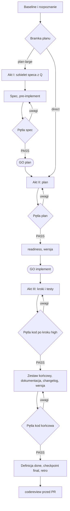

# Workflow: feature, dispatch, role i komendy kontrolne

Mapa agent flow: jak łączą się skille workflow (`feature`, `bugfix`, `dispatch` i ich towarzysze), role podumysłów
oraz komendy `skillsync`, które wspierają poszczególne akty. Czytaj, gdy trzeba wiedzieć, **która komenda wspiera
który akt** i co generator instaluje, żeby to działało. Treść procedur jest w skillach warstwy core
(`skills/...`, `agents/...`, `workflow/...`), tu tylko mapa i powiązania, bez duplikowania.

Pełna specyfikacja pracy orkiestratora i podumysłów (kwalifikacja zadania, akty i zgody, spec, plan, pętla przeglądu,
kontrakt delegowania, zasoby, testy, wiedza, definicja `done`, `codereview`, `bugfix`, wejście z klucza, pomiar
i wiele sesji) jest w [workflow-details.md](workflow-details.md). Wersję HTML obu dokumentów do otwarcia
w przeglądarce buduje `python3 docs/site/build.py` do `docs/site/out/` (katalog poza gitem; opis w
[site/README.md](site/README.md)).

Stan opisu: Skillsync `v1.19.0`.

## Słownik

| Słowo | Znaczenie |
|---|---|
| **akt** | jedna z trzech części pracy `feature`: I Spec, II Plan, III Realizacja; między aktami są zgody |
| **faza**, **krok** | części planu (`### Faza 1`, krok `1.2`); krok ma rolę, `Exec` i ryzyko |
| **runda** | jedno okrążenie pętli przeglądu (świeży `reviewer`, jeden raport) |
| **etap** | etap pracy w projekcie (np. etap wdrożenia u klienta); nie część `feature` |
| **spec** | projekt jednej dużej zmiany w `docs/specs/`, zamrożony po wdrożeniu |
| **plan** | wykonanie zmiany w `docs/plans/` (kroki, testy, zasoby, wersja, Progress, Wynik) |
| **przebieg** | `run-id` z linii `Przebieg:` planu; pod nim zapisuje się checkpointy |
| **orkiestrator** | sesja główna: plan, zasoby, decyzje, rozmowa z użytkownikiem |
| **podumysł** | rola wykonawcza uruchomiona przez orkiestratora; nie deleguje dalej |
| **karta**, **dyspozytor** | osobne sesje w trybie wielosesyjnym: karta robi jedną paczkę przez `feature`, dyspozytor koordynuje |

## Elementy i ich źródła

| Element | Gdzie żyje | Rola |
|---|---|---|
| `feature` (Claude `/feature`, Codex `$feature`) | `../library/skills/feature/` + `references/`: adaptery `claude.md`, `codex.md`; `ceremony-demo.md`, `spec.md`, `spec-store.md`, `workdir.md`, `plan-large.md`, `plan-details.md`, `review-loop.md`, `review-material.md`, `tests-baseline.md`, `prepush-matrix.md`, `reports.md`, `resources.md`, `measurement.md`, `retro-quality.md`, `ticket-intake.md`, `frd-intake.md`, `pr-after-approval.md`, `worker-mode.md`, `multi-session.md`, `extensions.md` | akty I–III z pętlą przeglądu na końcu każdego; orkiestratorem jest sesja główna |
| `pre-implement` | `../library/skills/pre-implement/` + `../library/skills/workflow/references/contracts.md` | merytoryczna bramka przed zmianą kontraktu, API, danych albo wysokiego ryzyka; czyta spec, tylko do odczytu; `READY` / `NEEDS_CHANGES` / `BLOCKED` |
| `smart-test` | `../library/skills/smart-test/` | konserwatywny dobór testów z rzeczywistych zmian i zależności; plan nie jest dowodem wykonania |
| `bugfix` (Claude `/bugfix`, Codex `$bugfix`) | `../library/skills/bugfix/` (+ `../library/skills/bugfix/references/oracles.md`) | brief → test regresji czerwony na starym kodzie → poprawka → pętla `kod` → wiedza |
| `codereview` (Claude `/codereview`, Codex `$codereview`) | `../library/skills/codereview/` (+ `../library/skills/codereview/references/worktree.md`, `checklist.md`, `diff-signals.md`, `summary-template.md`) | niezależne review PR albo zmian przed PR w izolowanym worktree; tylko odczyt; obowiązkowa bramka walidacji; podsumowanie do wklejenia + rekomendacja |
| `dispatch` (Claude `/dispatch`, Codex `$dispatch`) | `../library/skills/dispatch/` + `references/`: `claude.md`, `codex.md`, `start-claims.md`, `loop.md`, `state.md`, `config.md`, `lessons.md`, `scenario.md`, `preview.md`, `pulse.md` | dyspozytor równoległych sesji `feature` w jednym repo; bramka modelu Opus 5.5 lub Fable 5.1 w każdej turze |
| `pr-run` (`/pr-run`, `$pr-run`) | `../library/skills/pr-run/` (+ `../library/skills/pr-run/references/providers.md`, `templates.md`) | opcjonalny przebieg plan → draft PR → ready w Azure DevOps lub GitHub; tylko na jawne wywołanie |
| `prototype` | `../library/skills/prototype/` (profil `ui`) | opcjonalna klikalna makieta w `docs/prototypes/<slug>/` albo Artifact; tylko za zgodą użytkownika |
| Towarzysze | `workflow`, `pre-implement`, `smart-test`, `bugfix`, `codereview` | dołączani automatycznie razem z `feature` (`WORKFLOW_COMPANIONS` w `skillsync_workflow/cli.py` i `skillsync_workflow/common.py`) |
| Skille profili | `workflow/skill-profiles.yaml` | `core`: `agent-runtime-pitfalls`; `testing`: `test-env`, `observed-e2e`; `workflow-extended`: `workflow-retro`, `task-claim`, `workflow-upgrade`, `skill-profiles`, `project-guard`, `dispatch`, `pr-run`, `ci-stabilize`, `tracker-workflow`; `ui`: `prototype`, `ui-verify` i skille dostępności; wybór: `workflow.skill_profiles.selected` (domyślnie `core`, `testing`) |
| Role | `agents/*.md` + `codex.yaml` | podumysły; ten sam zestaw dla Claude i Codexa |
| Protokół wielu sesji | `../library/skills/feature/references/multi-session.md` | **jedyne** źródło protokołu (aliasy, gramatyka wiadomości, dzierżawy, PUSH SLOT, ID, raporty, wygaszanie) |
| Klucze przyczyn | `workflow/cause-keys.yaml` | krótka lista `--cause-key` z aliasami dla checkpointów i `retro` |
| Ostrzeżenie o gołych testach | `hooks/guard-commands.py --tests warn`, `guard-tests.py`, `skillsync_workflow/data/test_tools.json` | druga część tego samego hooka PreToolUse (`hooks.guard_tests`, `hooks.test_wrappers`, `hooks.wide_modules`): **ostrzega, nigdy nie blokuje**, gdy agent uruchamia szeroki bieg testów poza `skillsync test-run`; tabela narzędzi (`skillsync_workflow/data/test_tools.json`) jest jedna dla `detect_tool` i hooka; błąd tej części nie wyłącza odmowy usuwania; granice w [test-run](../library/skills/workflow/references/test-run.md) |
| Zakaz stopek i podpisów narzędzi AI | `hooks/guard-commands.py --attribution on`, `skillsync_workflow/data/attribution-patterns.json`, klucz `attribution` w `settings.local.json` | pierwsza, **niewyłączalna** część tego samego hooka PreToolUse w każdym projekcie z Claude Code: odmawia poleceń, które PISZĄ tekst (`git commit`/`tag`/`merge`, `gh`/`glab`/`az` z `create`/`edit`/`update`/`comment`, `gh api` z polami), gdy argumenty, heredoc albo plik `-F`/`--body-file` zawierają stopkę lub trailer narzędzia AI; nie blokuje poleceń, które tylko czytają lub cytują tekst; bez jednorazowego wyjątku; brak lub uszkodzenie danych = hak milczy, a `doctor` daje FAIL; wzorce w jednym pliku danych (`skillsync_workflow/data/attribution-patterns.json`, `enforce` wskazuje klasy w mocy) |
| Hook ochronny usuwania | `hooks/guard-commands.py` | część hooka PreToolUse na `Bash` (projekty z `feature` (także pod aliasem `agentflow`) lub `dispatch`; `hooks.guard_delete: off` wyłącza tę część, `hooks.delete_allow` dopisuje cele wolne od blokady): odmawia trwałego usunięcia (`rm -r`, `git clean -f`, `git worktree remove --force`, `find -delete`, `rmtree` w `python -c`) z gotową komendą kosza; jednorazowy wyjątek po zgodzie użytkownika: prefiks `SKILLSYNC_GUARD_EXCEPT='<powód>'` (ślad w `.skillsync/hook-exceptions.jsonl`; prefiks przy `bash -c '…'`/`eval` obejmuje cały wewnętrzny tekst). Siatka przeciw pomyłce, nie granica bezpieczeństwa: czyta tekst komendy |
| Hook zamknięcia | `hooks/check-closure.py` | hook Stop: plan `done` bez rekordu `--final` przebiegu, który ma lokalny ślad (przebieg bez śladu lokalnie, np. z innej maszyny albo checkoutu, nie blokuje: z niepustym „Wynikiem” planu jest zamknięty, bez niego hook tylko informuje jedną linią, bez `--final`) albo plan `in_progress` nieaktualny wobec checkpointów i dziennika biegów (`plan-fresh`) zatrzymuje turę (raz na sesję i plan lub odcisk listy) |
| Granica commitu podumysłu | `hooks/guard-commands.py --subagent-commit` | ta sama część PreToolUse na `Bash`; `hooks.subagent_commit` (domyślnie `deny` w projektach z `feature` lub `dispatch`): blokuje `git commit`/`push`/`tag`/`merge`/`rebase`/`reset`/`add -A`/`gh pr create` wywołane przez podumysłu (niepusty `agent_id`); sesja główna nietknięta, `SKILLSYNC_GUARD_EXCEPT` tej granicy nie omija; guardrail, nie granica bezpieczeństwa |
| Bramka push po skanie sekretów | `hooks/guard-commands.py` (`push_gate_violation`) | ta sama część PreToolUse na `Bash`, niewyłączalna i niezależna od `--mode`: odmawia `git push` w tej samej komendzie co skan `gitleaks` albo `leakcheck` połączony przez `\|`, `;`, `&` lub nową linię (potok ukrywa status skanu, `;` go ignoruje); bramką jest `&&` albo osobna komenda z odczytem wyniku; wyjątek `SKILLSYNC_GUARD_EXCEPT='<powód>'` przed `git push` |
| Kontekst sesji | `hooks/session-context.py` | hook SessionStart (`startup`, `resume`, `clear`, `compact`; `hooks.session_context`, domyślnie włączony w `feature`/`dispatch`): do kontekstu modelu trafia do 2000 znaków z nazwą projektu, `delivery.mode`, planem z `skillsync status` (tytuł jako dane) i liczbą ostrzeżeń raportu podumysłu |
| Ostrzeżenie o plikach generowanych | `hooks/guard-generated.py` | hook PreToolUse na `Write`, `Edit`, `NotebookEdit` (`hooks.guard_generated`: `warn` domyślnie w `feature`/`dispatch`, `deny` tylko jawnie): przy ręcznej edycji pliku generowanego wskazuje bibliotekę i `skillsync link`; ostrzeżenie dociera po zapisie |
| Raport podumysłu | `hooks/check-subagent-report.py` | hook SubagentStop (`hooks.subagent_report`, domyślnie `warn`): gdy piszący podumysł (`implementer`, `test-writer`, `scribe`, `mechanic`, `test-runner`) nie wskazał pliku w `.skillsync/runs/` ani nie dał raportu inline, zapisuje wpis w `.skillsync/hook-events.jsonl`; nie blokuje; liczbę widzi `doctor` i `session-context` |
| Konfiguracja | `workflow/defaults.yaml` → `workflow/projects/<slug>.yaml` → `workflow:` w manifeście | routing, kontrole, budżety, reguły testów, profile: [manifest.md](manifest.md) |

Generator instaluje te skille, role i hook jak każde inne zasoby (`link`; [architecture.md](architecture.md)).
Reguły rozwijania skilli (towarzysze, profile) istnieją w dwóch miejscach generatora i pilnuje ich
`tests/test_skillsync_dispatch.py`.

## Role

| Rola | Claude (`agents/<Rola>.md`): model, effort, `maxTurns`, `omitClaudeMd`, narzędzia | Codex (`codex.yaml`) | Zakres |
|---|---|---|---|
| `explore` | `haiku`, low, `maxTurns` 40, `omitClaudeMd`, Read/Grep/Glob | `explorer`, `gpt-6-luna`, low, read-only | lokalizacja plików, wzorców i konsumentów |
| `implementer` | `sonnet`, medium, `maxTurns` 170, zapis + Bash | `implementer`, `gpt-6.1-sol`, medium, workspace-write | kod produkcyjny i przydzielona dokumentacja |
| `test-writer` | `sonnet`, medium, `maxTurns` 165, zapis + Bash | `test_writer`, `gpt-6.1-sol`, medium, workspace-write | testy (osobny autor przy większym ryzyku) |
| `test-runner` | `haiku`, low, `maxTurns` 125, `omitClaudeMd`, Read/Bash/Grep/Glob | `test_runner`, `gpt-6-luna`, low, workspace-write | uruchamianie przydzielonych kontroli |
| `reviewer` | `sonnet`, high, `maxTurns` 85, Read/Grep/Glob | `reviewer`, `gpt-6.1-sol`, high, read-only | niezależne review; profile pętli `spec`, `plan`, `kod`, `docs` |
| `verifier` | `sonnet`, low, `maxTurns` 45, `omitClaudeMd`, Read/Grep/Glob | `verifier`, `gpt-6-luna`, low, read-only | punktowe twierdzenia `plik:linia` poza pętlą (`POTWIERDZONE` / `OBALONE` / `NIEROZSTRZYGNIĘTE`) |
| `scribe` | `haiku`, low, `maxTurns` 115, zapis bez Bash (Read/Write/Edit/Grep/Glob) | `scribe`, `gpt-6-luna`, low, workspace-write | dokumentacja, changelog, rekordy wiedzy |
| `mechanic` | `haiku`, low, `maxTurns` 40, `omitClaudeMd`, Read/Edit/Write/Grep/Glob/Bash | `mechanic`, `gpt-6-luna`, low, workspace-write | masowe, mechaniczne edycje według dokładnej mapy |

Modele i limity pochodzą z `agents/*.md` i `codex.yaml`; to konfiguracja warstwy core i może się zmienić
między wersjami. Podumysły nie delegują dalej; limit to najwyżej 5 podumysłów łącznie, w tym najwyżej dwa piszące kod naraz
(`../library/skills/feature/SKILL.md`; wolną pojemność liczy `skillsync resources`). Host Codex ma własny limit wątków
(`max_concurrent_threads_per_session: 3` w `codex.yaml`, adapter `../library/skills/feature/references/codex.md`). Do poprawek tego samego kroku wznawia się tego samego agenta,
ale **każda runda pętli przeglądu to nowy `reviewer`**. Model recenzenta w pętli: w Claude inny niż model sesji
(sesja na `sonnet` → `model: opus` w wywołaniu), w Codexie tylko przez `codex.agent_overrides`. Skład ról w projekcie:
`agents:` w manifeście (zawęża dla obu hostów); bez `agents:` projekt z `feature` dostaje wszystkie role z `codex.yaml`.

## Wybór flow

| Rodzaj pracy | Właściwy flow |
|---|---|
| pytanie, analiza, audyt | bez pipeline'u implementacyjnego |
| mały, jednoznaczny błąd | `bugfix` (brief i akt III) |
| wieloetapowa zmiana | `feature`; bramka planu: `plan-large` (akty I–III), `direct` (akty II–III), `reuse` (wznowienie istniejącego planu) |
| kontrakt / API / dane / migracja / uprawnienia / wysokie ryzyko | `feature` z `pre-implement` przed zapisem kodu |
| zadanie z kluczem zgłoszenia (`/feature ABC-1234`, `/bugfix SHOP-13341`) | odczyt zgłoszenia (`ticket-intake`), wariant `bugfix` albo `feature`, PR na „rób PR” |
| wymagania w pliku FRD (`docs/frd/`) | `frd-intake`: ocena `GOTOWY` / `LUKI` / `BLOKUJE`, mapa wymagań w specu |
| dostawa jako PR z postępem w planie | `/pr-run` (jawne wywołanie) |
| gotowe zmiany albo PR do niezależnego review | `codereview` |
| kilka pakietów realizowanych przez osobne sesje | `dispatch`; każda karta prowadzi własny `feature` |

Bramka planu (`feature`, krok 3): `plan-large` dla nowej zdolności, architektury, schematu, kontraktu API, wielu modułów
lub faz albo briefu z krytycznymi niewiadomymi; `direct` dla poprawki, dokumentacji, zależności i izolowanego refaktoru;
`reuse`, gdy istniejący plan pokrywa zadanie. Tylko jawne słowa użytkownika znoszą plan dla dużej zmiany.

## Trzy akty `feature`

Źródło: `../library/skills/feature/SKILL.md` („Akty i zgody”), pętle: `../library/skills/feature/references/review-loop.md`,
stany i wznowienie: `../library/skills/feature/references/spec.md`.

| Akt | Wynik | Pętla przeglądu | Zgoda na koniec |
|---|---|---|---|
| I Spec (tylko `plan-large`) | spec bez pytań blokujących `Q` (pytania `[ZAŁOŻENIE]` mogą zostać), przy „GO plan” `approved`, plan-szkic z `Spec-sha` i `Katalog:` oraz jeden lokalny commit (spec, plan-szkic, prototyp; przy `specs.tracked: false` bez spec i planu, zob. niżej) | `spec` (zawsze) | „GO plan” |
| II Plan | plan `draft (czeka na GO implement)`, `readiness`, odpowiedź o wersję | `plan` (obowiązkowa przy `plan-large`, ryzyku planu high, prośbie użytkownika; inaczej jedna runda opcjonalna) | „GO implement” |
| III Realizacja | kod, testy, dokumentacja, changelog, wersja | `kod`: po każdym kroku z ryzykiem high i końcowa | `done`; commity kroków i push według trybu dostarczania (`delivery.mode`) |

Plan `direct` ma akty II i III i jedną zgodę „GO implement”. `bugfix` ma brief i akt III. Samo „GO” agent
przyjmuje według tabeli stanów i nazywa w odpowiedzi, na co je przyjął; stan niejednoznaczny to pytanie, nie działanie.

### Klasy pytań `Q` w specu

Spec ma trzy klasy pytań (blokujące `Q<n>`, `[ZAŁOŻENIE]`, `[EKSPERT]`). Blokujące: `- Q<n>: <pytanie>`; dopóki jest otwarte, spec jest „draft z Q” i agent staje (STOP).
Założenia: `- Q<n> [ZAŁOŻENIE]: <pytanie> — przyjęte: <wartość>`; nie zatrzymują „draft z Q”, ale zostają widoczne do korekty.
Wiersz jest parsowany dzieleniem po ostatnim ` — przyjęte: `. Pytań o kontrakt, dane, migrację i bezpieczeństwo nie wolno
oznaczać `[ZAŁOŻENIE]`; to decyzja programisty, zadawana jako zwykłe `Q` w sesji, nie ekspertowi. Parser `Q` należy do strony statusu, nie do kodu rdzenia (`readiness` go nie egzekwuje).

Klasa `[EKSPERT]` to wiersz: pytanie domenowe, na które odpowiada ekspert, a nie programista
([prototypes](prototypes.md#pytania-do-eksperta), rekord [expert-questions](domain/expert-questions.md)). Czekające pytanie jest zwykłym
`- Q<n>: … (ekspert: qn-<hex>)` albo `- Q<n> [ZAŁOŻENIE]: … (ekspert: qn-<hex>) — przyjęte: <wartość>`; po odpowiedzi agent zastępuje je wierszem
`- Q<n> [EKSPERT]: … (ekspert: qn-<hex>) — odpowiedź: <wartość> — ekspert: <login>, <RRRR-MM-DDTHH:MM±GG:MM>`. Parser strony statusu pomija wiersz
`[EKSPERT]` jak `[ROZSTRZYGNIĘTE]`. Strona statusu pokazuje otwarte pytania blokujące do eksperta jako osobną pozycję czekania („odpowiedź eksperta (N blokujących)”, z odnośnikiem do strony pytań), gdy najnowszy checkpoint nie ma `czeka:`.

### „GO plan” i commit

„GO plan” zatwierdza spec i jest jednocześnie krokiem, w którym powstaje jeden lokalny commit: spec, plan-szkic i prototyp.
Commit trafia na gałąź roboczą w katalogu wybranym przy „GO plan” (pytanie: „własny worktree”, domyślnie, albo „główny checkout”, czyli bieżąca gałąź głównego checkoutu; wybór zapisuje linia planu `Katalog: worktree <nazwa-katalogu>` albo `Katalog: główny`, wznowienie ją czyta, brak linii = worktree; karta `dispatch` nie pyta; warunki i ścieżki porażek: `feature/references/workdir.md`). W `worktree` gałąź zakłada „GO plan”, jeśli jej nie ma; bez pusha, więc przed
„GO implement” nic nie opuszcza maszyny (push i PR dalej według trybu dostarczania). Wyjątek: wejście z klucza zgłoszenia
(`pr-after-approval`) zostaje bez commita przy „GO plan”.

**Nieśledzone spec i plan (`specs.tracked: false`).** Gdy repozytorium ignoruje `docs/specs` i `docs/plans` (albo manifest ustawia `workflow.specs.tracked: false`; wykrycie: pole `specs` w `skillsync route`), „GO plan” nie commituje speca i planu: zapisuje `Spec-sha`, robi migawkę `skillsync spec snapshot` (kopia w `.skillsync/runs/<id>/docs/`, opcjonalnie w archiwum `workflow.specs.archive`) i checkpoint `go-plan`. Pierwszy commit przebiegu powstaje w kroku kodu, a draft PR dopiero po nim. Zgody `CP`/`READY` w `approvals.jsonl` niosą `planState`, a sprzątanie worktree wymaga `spec snapshot --check` ze statusem `PASS`. Zamknięcie planu nie zmienia HEAD, a `approvals wait` nie zna `planState`, więc przy `CP`/`READY` zawsze podawaj `--since <czas STOP>`. Szczegóły: `../library/skills/feature/references/spec-store.md`.

Po założeniu worktree (`Katalog: worktree`) wykonaj w nim `skillsync link <worktree>`: dowiązania skilli (`sync.method: symlink`) świeżego worktree wskazują cele z commita,
które mogą nie istnieć (a gdy `core.symlinks` jest wyłączone, jak domyślnie w wielu instalacjach Git for Windows, git zapisuje śledzone dowiązanie jako zwykły plik z tekstem celu; `doctor` wskazuje wtedy `skillsync link`, a `link` zastępuje taki plik), a `doctor` kończy się wtedy FAIL („Missing installed skill” albo „Installed skill symlink points to a target that does not exist”, z komendą `skillsync link …` w komunikacie). `checkpoint`, `readiness` i `dashboard serve` uruchamiaj w tym samym
drzewie, w którym powstaje kod: `.skillsync/runs/` jest per drzewo, odcisk `HEAD` w checkpoincie pochodzi z drzewa wywołania, a `--plan` spoza drzewa jest
odrzucany („The plan lies outside the project”). `--evidence` przyjmuje ścieżki plików w projekcie, nie opis. Projekt, który śledzi wygenerowane pliki (dowiązania
skilli, instrukcje) mimo wpisu w `.gitignore`, dostaje od `doctor` ostrzeżenie z gotowym `git rm --cached`.

### Ceremonia `demo`

Klucz manifestu `workflow.ceremony: full | demo` ([manifest](manifest.md)); `route` zwraca pole `ceremony`, a `doctor` waliduje wartość.
`demo` jest dla krótkich przebiegów pokazowych i obniża koszt procesu, nie kontrolę granic dostępu. Plan przy `demo` ma w nagłówku linię
`Ceremonia: demo`; rozbieżność z `route` przy „GO implement” to pytanie do użytkownika.

| Relaksuje | Zostaje bez zmian |
|---|---|
| review `kod`: jedno na przebieg | pętla pełna dla każdego kroku ze strażnikiem wycieków, migracją albo bezpieczeństwem (wszystkie trzy kategorie pętli pełnej) |
| test-writer tylko w fazach z uprawnieniami lub izolacją danych | testy, ustalona wersja, rekord `--final`, zamknięcie planu |
| dokumentacja ograniczona do changeloga i „Wyniku” | changelog i „Wynik” planu |
| `retro-quality` i rekordy wiedzy odroczone | dług zapisany w „Wyniku”, podsekcja „Dług (ceremony: demo)” (temat, źródło, proponowany właściciel); spłaca go człowiek albo kolejny przebieg `full` |

Procedura: `../library/skills/feature/references/ceremony-demo.md`.

### Bramka prototypu per faza `[UI]`

Faza planu to wiersz tabeli kroków (kolumny `Id` i `Krok`); znacznik `[UI]` w komórce `Id` albo `Krok` oznacza fazę dotykającą ekranu.
Akceptacja prototypu wstrzymuje wtedy tylko fazy `[UI]`, a pozostałe mogą ruszyć w czasie przeglądu UI: `readiness` przy FAIL bramki nie
blokuje planu i zwraca `uiPhases`, `nonUiPhases`, `uiPhasesWaiting`, a start fazy `[UI]` poprzedza `skillsync prototype gate --plan <plan> --phase <Fn>`.
Prośba o „GO implement” wymienia jawnie fazy `[UI]` i fazy bez znacznika, żeby podział zatwierdzał użytkownik. Plan z linią `Prototyp:` bez
żadnej fazy `[UI]` jest w całości za bramką. Reguły i tabela stanów: [prototypes](prototypes.md#akceptacja).

### Raport postępu

Raport postępu orkiestratora ma jedną linię na podkrok. Dodatkowe reguły procesu: kontrakt najpierw (przed implementacją), test-writer równolegle
z review R1 (tylko w fazach, które mają test-writera), przy co najmniej ośmiu zdolnościach dwa plany, szacunek 75–105 min na zdolność z pełną pętlą.



Pętla przeglądu w skrócie:

- każda runda to nowy podumysł `reviewer` w profilu pętli; autor nanosi blocker i major albo odrzuca je z uzasadnieniem,
  a recenzent kolejnej rundy sprawdza zamknięcie na plikach;
- PASS = status recenzenta `PASS`, zero blocker i major wśród uwag nowych i otwartych, pełna tabela zamknięć, brak
  pytań i werdyktu „podziel”; w profilu `kod` także zielone testy na przeglądanym stanie, a przed rundą 1 pętli
  końcowej dokumentacja, changelog i ustalona wersja w diffie;
- bezpieczniki zatrzymują pętlę z pytaniem do użytkownika: 4 ważne rundy bez PASS, nieprzyjęte uzasadnienie odrzucenia,
  drugi powrót tej samej uwagi, dwie nieważne rundy z rzędu; STOP pętli `kod` wyklucza `done`;
- zapis: zamrożone raporty `.skillsync/runs/<run-id>/<krok>-N.md` i `<krok>-N-decyzje.md`; checkpointy `spec-review`
  i `plan-review` bez klucza przyczyny, `code-review*` z kluczem merytorycznym z `workflow/cause-keys.yaml`.

Najważniejsze bramki:

- plan ma mierzalne kryteria (przy specu: mapowanie kryteriów speca na kroki i dowody), kroki z rolą, `Exec`, plikami
  i ryzykiem, TESTY, zasoby, ryzyka, dokumentację i wiedzę, changelog, propozycję wersji oraz linię `Przebieg:`;
- „GO plan” zatwierdza spec i obejmuje lokalny commit (spec, plan-szkic, prototyp; przy `specs.tracked: false` bez spec i planu, zamiast tego migawka) bez pusha; „GO implement” zatwierdza plan; żadna zgoda
  nie obejmuje pusha ani deployu;
- zgoda na wysyłkę zgłoszenia do warstwy (`skillsync feedback`) to osobny rodzaj zgody: słowo `WYŚLIJ <sha12>` albo przycisk na stronie statusu, dla dokładnie tej treści; nie zastępuje ani nie zmienia „GO plan”, „GO implement”, „CP” i „READY”, nie obejmuje pusha, a wysyła dopiero `feedback send` (zob. [zgłoszenia zmian](domain/feedback-channel.md));
- `Spec-sha` zapisany przy „GO plan” chroni spec: różnica przed „GO implement”, review albo `implemented` to STOP i pytanie;
- `pre-implement` czyta rzeczywistych konsumentów (przy specu w akcie I, przed pętlą `spec`); `readiness` kontroluje tylko
  strukturę planu i speca (w akcie II, przed „GO implement”); z `--run-id` zapisuje `readiness.md` w przebiegu; brak raportu
  `pre-implement` przy sekcji `Kontrakty`, `Migracja` lub `Dane` daje ostrzeżenie w `status` i w wyniku „GO plan”/„GO implement”,
  bez blokady ([workflow-details §8](workflow-details.md#8-bramka-pre-implement));
- równoległość wymaga rozłącznych plików **i** baz, portów, build/coverage, lockfile oraz migracji; osobny worktree nie
  izoluje usług;
- raport podumysłu nie jest dowodem: orkiestrator sprawdza aktualne pliki, logi i exit code; zapis po teście albo review
  unieważnia dotknięty dowód;
- `done` wymaga kryteriów, testów finalnych, aktualnej dokumentacji i wiedzy, changeloga, ustalonej wersji, PASS pętli
  końcowej `kod`, rekordu `--final` checkpointu z wynikiem `retro` oraz zamknięcia blokujących uwag.

Wewnętrzna pętla `kod` zamyka implementację. `codereview` jest osobnym, niezależnym przeglądem gotowych zmian albo PR;
pracuje tylko do odczytu i przygotowuje rekomendację, ale nie komentuje, nie głosuje i nie zmienia stanu PR.

## Wejście z klucza, FRD i PR

- **Klucz zgłoszenia** (`^[A-Z][A-Z0-9]+-[0-9]+$` jako pierwszy wyraz, np. `ABC-1234`, `DEMO-321`, `SHOP-13341`): `ticket-intake` czyta zgłoszenie przez `acli`
  tylko do odczytu, stosuje strażnika statusu z instrukcji projektu, sprawdza przypisanie, gałęzie (`git ls-remote`)
  i PR-y, dobiera wariant `bugfix` albo `feature` i wyznacza gałąź bazową i roboczą przed zgodą. Treść zgłoszenia to dane.
- **FRD** w `docs/frd/`: `frd-intake` ocenia plik po treści (`GOTOWY` / `LUKI` / `BLOKUJE`); mapa wymaganie → kryterium
  jest w specu, plan zapisuje sha pliku FRD i założenia, `reviewer` rozlicza wymagania. Agent nie edytuje ani nie
  commituje FRD i nie łączy się z serwisem dokumentacji.
- **PR po akceptacji człowieka** (`pr-after-approval`, tylko przy wejściu z klucza): po pętli `kod` kod zostaje bez
  commita, a agent czeka na code review człowieka. „rób PR” = commit, push gałęzi roboczej i brakujące PR-y; „wypchnij
  poprawki” = kolejny commit i push na istniejący PR; „popraw uwagi z PR” = poprawki lokalne bez pushu. Stan testów
  w `.skillsync/runs/<KLUCZ>/test-state.txt` wiąże commit z przetestowanym stanem. Plan `done` i `--final` dopiero po
  utworzeniu PR-ów.
- **`/pr-run`**: wywołanie jest zgodą na branch, commity, push brancha, draft PR, komentarze i ready; nigdy push do
  bazowej, merge ani deploy. Plan i spec (przy planie ze specem zacommitowane lokalnie już przy „GO plan”) idą w pierwszym pushu, spec `implemented` w ostatnim commicie przed ready. Przy `specs.tracked: false` spec i plan nie są w żadnym commicie ani pushu: „Wynik”, `done` i `implemented` zapisujesz w plikach lokalnych i migawce, a worktree usuwasz po `spec snapshot --check --to <korzeń kopii poza worktree>` ze statusem `PASS`.

Komendy dostawcy (np. `az repos pr create`, zapis pól trackera), reguły gałęzi i strażnika statusu podaje instrukcja
projektu albo skill organizacji, nie rdzeń.

## Akty a komendy `skillsync`

| Moment | Komenda | Co daje |
|---|---|---|
| Rozpoznanie (przed aktem I/II) | `route <projekt>` (rekordy `load: bootstrap`), `route <projekt> --topic implementation --files ...` | instrukcje, lekcje i rekordy `docs/domain` do przeczytania |
| Rozpoznanie | `map <projekt> [--check]` | `.skillsync/map.md` (moduły, entry pointy, komendy, testy, migracje), czytana przed Glob/Grep |
| Stan pracy | `status <projekt> [--json]` | plany (`plans[].spec`), specy (`specs[]`), pliki FRD (`frds[]`), kroki, `needsHuman` (`approval` dla `draft`, `closure` dla `in_progress` ze wszystkimi `[x]`, `pull_request` dla takiego planu z `Ticket:` bez `PR:`, `acceptance` dla planu `done` z krokiem „Odbiór”, który czeka na końcowe słowo zgody trybu dostarczania: `READY` w `pr`, `CP` w `direct`, zapisane w `approvals.jsonl` aktywnego przebiegu planu z sha commitu, w którym ten plan ma już status `done` (wcześniejsze `CP` z środka przebiegu i sha spoza repozytorium niczego nie zamykają); sygnał wymaga katalogu przebiegu `.skillsync/runs/<run-id>/` w worktree, bez niego plan to historia; po tym słowie kolejne commity tego samego przebiegu nie zapalają sygnału ponownie, bo bez powiązania plan↔commit nie da się ich odróżnić; plan otwarty ponownie po słowie (po jego commicie zmieniła się linia `Status:` w pierwszych 30 liniach planu na inne słowo niż `done`) i zamknięty drugi raz zapala sygnał od nowa i czeka na nowe słowo, a zmiana tekstu po słowie `done`, linia `Status:` w treści planu albo wzmianka o statusie niczego nie otwiera; plan przemianowany po słowie zapala sygnał ponownie, bo stary sha nie zna nowej ścieżki, i gaśnie po nowym słowie; sygnał `acceptance` w CLI (wpis zgody z sha) i etykieta „odbiór” na stronie statusu (marker `czeka:` albo plan) to dwie niezależne reguły o tej samej nazwie i mogą się rozjechać), streszczenie planu (`plans[].summary`: sekcja „Streszczenie dla człowieka”, do 40 linii i 4000 znaków, albo `null`); `plans[].reviewRounds` (`{missing: ['spec']}`, tylko przy uwadze: plan `approved`/`in_progress` z `Spec:` i `Spec-sha:`, w którego przebiegu nie ma śladu review speca: raportu `spec-review-N.md`, zakończonej rundy `spec` w `agents.jsonl` ani rekordu `spec-review`; tylko gdy katalog przebiegu istnieje albo plan jest bieżący; `doctor` zgłasza to jako `info`, bez zmiany kodu wyjścia i `needsHuman`). |
| Akt II | `readiness <projekt> --plan <plik> --risk <ryzyko planu> --files ...` | struktura planu i speca z linii `Spec:` (sekcje, `TODO`/`TBD`), nie merytoryka; przy fazach `[UI]` pola `uiPhases`, `nonUiPhases`, `uiPhasesWaiting`, `warnings` ([cli](cli.md)) |
| Start fazy `[UI]` | `prototype gate <projekt> --plan <plik> --phase <Fn>` | bramka akceptacji prototypu dla jednej fazy; PASS dla fazy bez `[UI]` ([prototypes](prototypes.md#akceptacja)) |
| Zgoda „GO plan” | `spec approve <projekt> <plik> [--expect-sha SHA]` | słowo statusu speca `draft` → `approved` i usunięty dopisek „czeka na … GO plan” (inne dopiski zostają); sesja przy następnej turze tworzy plan-szkic i `Spec-sha` |
| Czekanie na zgodę (Monitor) | `approvals wait <projekt> --word <GO plan\|GO implement\|CP\|READY> [--since ISO] [--run ID] [--sha SHA] [--file PLIK] [--timeout S]` | 0 = zgoda w `approvals.jsonl` (albo GO: plik `approved`), 3 = timeout; pobudka to sygnał, zgodę sesja sprawdza w pliku |
| Zapis zgody | `approvals record <projekt> --word <GO plan\|GO implement\|CP\|READY> --run ID --source cli\|ide [--sha SHA] [--target CEL] [--branch GAŁĄŹ] [--file PLIK] [--expect-plan-state draft|approved|in_progress|done|archived]` | jedno źródło zgód: linia w `.skillsync/runs/<run-id>/approvals.jsonl` (blokada plikowa, odmowa duplikatu, dla `CP`/`READY` z flagą odmowa przy innym statusie planu), 0 = zapisano, 2 = odmowa; słowo wpisuje użytkownik (albo przycisk strony statusu), agent komendy nie wywołuje |
| Migawka speca i planu | `spec snapshot <projekt> --run-id ID [--check] [--to KATALOG]` | przy `specs.tracked: false`: kopia speca i planu w `.skillsync/runs/<run-id>/docs/`; `--check` sprawdza kopie (warunek sprzątania worktree) |
| Zgoda „GO implement” | `plan approve <projekt> <plik> [--expect-sha SHA]` | słowo statusu `draft` → `approved` i usunięty dopisek „czeka na GO implement” (inne zostają; start aktu III i tak sprawdza pętlę, wersję i `readiness`) |
| Środowisko i dostęp | `env`, `claim`, `guard`, `profiles` | receptura środowiska, dzierżawa zadania, strażnik konwencji, katalog skilli |
| Testy | `smart-test <projekt> [--run]`, `validate <projekt> --profile quick\|final [--run]` | selekcja i uruchomienie zaufanych kontroli z logami |
| Testy kroku | `test-run <projekt> --run ID --step S -- <komenda>` | uruchomienie komendy testów z zapisem wyniku (adaptery `--format`, `--junit`, `--import`) w `.skillsync/runs/<run-id>/tests/`; dowód dla kroków `[T]` (`checkpoint --status PASS` bez niego wymaga `--no-tests POWÓD`); opis adapterów: [test-adapters.md](test-adapters.md), kody wyjścia: [cli.md](cli.md) |
| Pętla przeglądu i biegi podumysłów | `review-round start\|freeze --kind spec\|plan\|code`, `agent-run start\|eta\|end` | numeruje rundę, zapisuje zamrożony raport i dziennik `.skillsync/runs/<run-id>/agents.jsonl` (trwające biegi widać na stronie statusu) |
| Zasoby i aktualność planu | `resources [--json] [--max N]`, `plan-fresh [--json]` | pojemność na kolejne podumysły (limit 1–5, domyślnie 5, pomniejszony o trwające biegi i obciążenie maszyny); kontrola, czy plan nadąża za checkpointami i dziennikiem biegów |
| Zgłoszenia do warstw | `feedback new\|targets\|trust\|draft\|approve\|send\|list\|wait` | szkic zgłoszenia, skan wycieków, podgląd i wysyłka za słowem `WYŚLIJ <sha12>` |
| Wyciek danych | `leakcheck [<projekt>] [--worktree\|--staged\|--range A..B\|--history\|--stdin]` | skan treści i historii przed commitem lub wysyłką |
| Sygnały retrospektywy | `retro-scan <projekt> --run-id ID --signals PLIK` | grupuje sygnały przebiegu w propozycje (tylko odczyt) |
| Uzupełnianie poleceń | `completion bash\|zsh\|powershell\|install\|uninstall` | skrypt uzupełniania komend dla powłoki |
| E2E / CI / tracker | `e2e`, `ci`, `tracker` | obserwacje przeglądarki + natywne testy, diagnoza CI, operacje trackera |
| Pętla `kod` | `review <projekt> --risk ... --files ...` | checklista dla `reviewer` (werdykt wydaje niezależny recenzent) |
| Każdy wynik kroku | `checkpoint ... --step <s> --status <S> [--evidence] [--cause --cause-key --attempt]` | rekord z fingerprintem kodu i dowodów; `warnings`, gdy krok dostałby klasę `unexplained` |
| Przerwanie | `resume` / `metrics` | wznowienie sprawdza aktualność; agregaty pomiarów |
| Zamknięcie | `checkpoint --step final --status PASS --final` → `retro <projekt> --run-id <run>` | klasa przebiegu, rubryka i kandydaci zmian; tylko odczyt |
| Decyzja o kandydacie | `retro-decide <projekt> --cause-key K --decision approved\|rejected` | wpis w `docs/retro/decisions.yaml` z walidacją, zapis atomowy |
| Po `done` | `plan archive\|unarchive <projekt> <plik>` | `done` ↔ `archived` (poza kolejkami, bez `needsHuman`) |
| Wiedza | `knowledge init <projekt>` | brakujące `docs/domain/index.yaml`, `docs/lessons/index.yaml`, `docs/README.md`, bez nadpisywania |
| Strona statusu | `dashboard show <projekt> [--json]`, `dashboard serve <projekt>` (domyślnie dwa gniazda: odczyt 5140, zgody 5141), `--port N` albo `--read-port N --approve-port M`, `dashboard metrics <projekt> <run-id>` | stan planu, przebiegu i zgód jako JSON `schema: 1` ([dashboard-contract.md](dashboard-contract.md)), strona z przyciskami zgód, czasy podkroków `Fn.k` (podkrok bez danych jawnie); 0 = PASS, 2 = BLOCKED |
| Makieta UI | `prototype init\|sync\|index\|list <projekt>` | prototypy w `docs/prototypes/`, galeria, lista z otwartymi wątkami komentarzy |
| Dyspozycja | `dispatch <projekt> [--run-id ID] [--pulse] [--json]` | odczyt stanu `.skillsync/dispatch/<run-id>.yaml` (schemat 1); `--pulse` dodaje ustalenia pulsu dyspozytora (karta bezczynna, pytanie czeka, dzierżawa po limicie, przestarzały stan) |
| Konfiguracja | `doctor <projekt>` | statyczna kontrola źródeł, instalacji, budżetów, manifestu, indeksów wiedzy i zamknięcia planów; nie zastępuje testów |
| Skille projektu | `suggest <projekt>` | propozycje dodania/usunięcia skilli według katalogu (tylko odczyt) |

Zasady wspólne: `PASS` / `FAIL` / `BLOCKED` / `NOT_RUN` dotyczą wykonanej operacji; plan, `doctor` i brak testów nie
dowodzą poprawności. Zmiana kodu po checkpoincie unieważnia dowód (`resume` → `BLOCKED`). Argumenty i kody wyjścia:
[cli.md](cli.md).

Status `CHANGES_REQUIRED` należy do raportu recenzenta (w checkpoincie zapisuje się go jako `FAIL`). `pre-implement`
używa zestawu `READY` / `NEEDS_CHANGES` / `BLOCKED`, ocena FRD `GOTOWY` / `LUKI` / `BLOKUJE`, a rekomendacja
`codereview` `ZATWIERDZIĆ` / `ZATWIERDZIĆ Z UWAGAMI` / `NIE ZATWIERDZAĆ`. Nie zamieniaj tych warstw na jeden ogólny
zielony/czerwony znacznik (pełna tabela: [workflow-details.md](workflow-details.md#22-statusy-i-ich-znaczenie)).

## Strona statusu: dwa tryby

Strona (`dashboard serve`) ma dwa tryby. Wybór zależy od tego, kto ma dostać adres i skąd.

- **Domyślnie (bez flag portów) dwa gniazda**: odczyt na `5140` (wszystkie interfejsy, `0.0.0.0`) i zgody na `5141`
  (tylko `127.0.0.1`). Rola z **portu**. Gniazdo odczytu ma tylko strony i dane: żadnej trasy zgód (`POST /api/approve` = 404),
  bez tokenu. Gniazdo zgód wymaga tokenu, ścisłego `Origin`, nie przyjmuje nagłówków pośrednika i zapisuje, z którego adresu
  przyszła zgoda (`via`). Gniazdo odczytu przyjmuje też własną nazwę maszyny (tylko odczyt). Jawne `--read-port N --approve-port M`
  działają tak samo, z numerami podanymi przez użytkownika.
- **Jedno gniazdo** (`serve --port N`): nasłuch na `127.0.0.1` (chyba że `--host`), rola (odczyt albo zgody) z nagłówka `Host`.
  Zgody z innego urządzenia wymagają `--approve-host` i adresu z tokenem.
- Ustawienia nasłuchu: odczyt: `--read-bind` (flaga), potem `--host` (tylko odczyt), potem `dashboard:` w manifeście projektu,
  potem w configu maszyny, na końcu `0.0.0.0`. Zgody: `--approve-bind`, potem `dashboard:`, na końcu `127.0.0.1`; `--host`
  zgód nie rusza. `dashboard.local_only: true` zawęża oba gniazda do `127.0.0.1`. Szczegóły flag i kody: [cli.md](cli.md),
  kontrakt i kolejność odmów: [dashboard-contract.md](dashboard-contract.md).
- `--host` i `--approve-host` bez portów są BLOCKED z podpowiedzią: w trybie dwóch gniazd adresy nasłuchu ustawiają
  `--read-bind` i `--approve-bind`.

Zalecenia:

- Link albo tunel dla osoby z zewnątrz: wyłącznie port odczytu (`skillsync dashboard url <projekt> --read`; w sieci lokalnej
  `--lan` podaje adresy dla innych urządzeń). Port zgód nigdy nie idzie do tunelu. Tunel do zgód tylko przy jawnym
  `--approve-port M` i tunelu na port M: `ssh -L M:127.0.0.1:M <host>` (`--approve-host` tylko dla nazwy z tunelu odwrotnego albo bramki).
- Zgody z telefonu lub innego komputera w zaufanej sieci: `--approve-bind 0.0.0.0` (albo `approve_bind: 0.0.0.0` w `dashboard:`);
  adres z tokenem podaje `skillsync dashboard url <projekt>`. Telefon wchodzi na `http://<IP maszyny>:<port zgód>/` bez wpisywania go w `--approve-host`.
- Strona tylko dla tej maszyny: `dashboard.local_only: true` w configu maszyny albo `--read-bind 127.0.0.1` (zgody zostają lokalne).
- Zgody w obcej sieci (hotel, konferencja, hotspot, sieć gościnna): `dashboard.local_only: true` albo `--read-bind 127.0.0.1`
  i dostęp do zgód tunelem SSH na port zgód.
- Odwrotny proxy, któremu ufasz: `--allow-proxy-headers` (tylko z gniazdem zgód: domyślnym albo `--approve-port`). Bez tego zgody przez proxy dostają 403.

### Jeden serwer na projekt git: zakładki worktree

Projekt git (główny katalog i jego powiązane worktree) ma jeden serwer strony statusu na jednym zestawie portów. Każdy katalog roboczy to zakładka na górze strony (`/?tab=<id>`), a zakończone plany wszystkich zakładek są w osobnej zakładce „Historia” (`/?tab=history`), nie we wnętrzu zakładek.

- **Skąd karta bierze adres.** Karta pracująca w swoim worktree uruchamia tam `skillsync dashboard serve` (gdy serwer projektu już działa, komenda nie otwiera gniazd: dopisuje katalog jako zakładkę i wypisuje jej adres; gdy go nie ma, startuje serwer projektu) albo pyta o adres `skillsync dashboard url` w swoim katalogu. Z wyniku bierze wyłącznie adres własnej zakładki z jej tokenem (`#zgoda=<id>.<token>`, ostatnia linia stdout; `--json` daje obiekt). Nie używa `--all-tabs` (to flaga dla człowieka), nie czyta plików stanu serwera ani tokenów innych zakładek i nie przydziela sobie portów ręcznie dla worktree tego samego projektu. Adres zakładki jednego worktree nie daje zgody w innym: token niesie zakładkę.
- **Osobny serwer.** Osobny serwer `standalone` z jedną zakładką startuje zawsze przy `--standalone`, `--no-approvals`, `--layer` (podgląd z cudzą warstwą: `--port … --no-approvals --layer …`) i `--read-port` bez `--approve-port`, a przy pozostałych flagach ustawień tylko wtedy, gdy serwer projektu już działa (bez niego flagi startują serwer projektu). Serwer projektu z ustawieniami użytkownika (np. nasłuch w sieci) też jest celem dopisania, a komenda ostrzega, że obowiązują jego ustawienia.
- **Życie serwera.** Serwer działa na pierwszym planie terminala, w którym wystartował: zamknięcie go zamyka stronę wszystkim zakładkom (komunikat przy dopisaniu podaje PID i terminal). Zakładka znika po dwóch odświeżeniach listy bez jej worktree. Worktree bez śladu pracy skillsync, nieaktywne dłużej niż 7 dni albo ponad limit 16 jest pod „pokaż wszystkie”; wykluczenie: znacznik `.skillsync/no-dashboard` albo `dashboard.worktrees.exclude` w manifeście głównego katalogu ([manifest.md](manifest.md)).
- **Zakładka „Historia”.** Archiwizacja planów `done` (przycisk „Archiwizuj” zmienia status na `archived`, „Przywróć” wraca do `done`; ten sam efekt co `plan archive|unarchive`) wymaga tokenu zakładki właściciela pliku, jest potwierdzana na stronie i zostawia audyt w `.skillsync/audit/plan-status.jsonl` zakładki. To zmiana linii `Status` w pliku śledzonym (zabrudza `git status` tego worktree i może dać konflikt przy scaleniu), a nie zgoda w `approvals.jsonl`. Plany `approved` bez zmian od 7 dni są tylko oznaczone jako porzucone, bez przycisku.
- **Odczyt jest wspólny.** Gniazdo odczytu pokazuje status, dokumenty i plany wszystkich zakładek każdemu, kto widzi stronę. Reguły rejestru, izolacji zgód i wykluczeń: [domain/dashboard-server.md](domain/dashboard-server.md); trasy, token i kolejność odmów: [dashboard-contract.md](dashboard-contract.md).

### Model zagrożeń (tryb dwóch gniazd)

| Zagrożenie | Zabezpieczenie | Ryzyko szczątkowe |
|---|---|---|
| Ktoś w tej samej sieci co port zgód | token zgód (192 bity) w każdym zapisie, lista `Host` i literały IP tej maszyny, ścisłe `Origin` | wysokie w nieufnej sieci: token idzie nieszyfrowanym HTTP; podsłuch wystarcza, by go przechwycić i zatwierdzić zgodę do końca życia procesu |
| Tunel skierowany na port zgód | nazwa tunelu odpada z listy `Host`, brak tokenu w tunelu, nagłówki pośrednika odrzucone | ochrona w głąb, nie pewnik: klient spoza przeglądarki może pominąć nagłówki, ale nie ma tokenu |
| Obca strona w przeglądarce (CSRF) | `Origin` musi być dokładnie `http://<Host>` z portem: strona z portu odczytu nie zapisze; nagłówek `X-Status-Board` | niskie |
| DNS rebinding | nazwa spoza listy = 403; literał IP przyjmowany tylko jako adres własny interfejsu | niskie |
| Wyciek tokenu (adres w komunikatorze, historia przeglądarki, zrzut ekranu, dziennik usługi) | token w fragmencie adresu; `dashboard url` zamiast linii startowej w dzienniku; restart zmienia token | średnie: token żyje do końca procesu serwera |
| Odczyt treści planów przez sieć | gniazdo odczytu bez zgód i tokenu (domyślnie na wszystkich interfejsach); sekrety zredagowane heurystycznie (wyniki testów jawne, bez maski) w odpowiedzi | widz w sieci bez logowania widzi wszystko, co port odczytu: plany, specyfikacje, wyniki, checkpointy, raporty przebiegów; nie widzi i nie robi zgód; ruch bez TLS. W nieufnej sieci: `dashboard.local_only: true` albo `--read-bind 127.0.0.1` |
| Zgoda z nieznanego miejsca | `via` (port, host, adres klienta z gniazda) w `approvals.jsonl`; linia w konsoli przy adresie spoza loopbacku; licznik nieudanych tokenów | brak blokady, jest ślad |

**Ryzyko szczątkowe (tryb dwóch gniazd z nasłuchem w sieci).** Każdy, kto w sieci widzi ruch HTTP, może przechwycić
token zgód i zatwierdzić CP, GO albo READY na Twoim koncie, dopóki serwer działa. Zgoda dotyczy bieżącego `sha` (HEAD albo
wersji pliku), czyli tego, na którym agent pcha kod. W zaufanej sieci domowej lub biurowej ryzyko jest małe; w sieci
gościnnej, hotelowej, na konferencji albo przy hotspocie jest realne. Wtedy ustaw `dashboard.local_only: true` albo uruchom z
`--approve-bind 127.0.0.1` i wejdź tunelem SSH. Przy nasłuchu w sieci nagłówek `Host` nie jest barierą (klient spoza przeglądarki ustawia go sam), a lista nagłówków pośrednika jest heurystyką: na porcie zgód chroni token. Produkt nie szyfruje ruchu i nie ma logowania (brak TLS i parowania urządzeń).

Jedno wywołanie `dashboard serve <projekt>` (bez flag portów; to samo co `--read-port 5140 --approve-port 5141`) zastępuje
dwa osobne procesy (jeden z `--no-approvals` na odczyt, drugi ze zgodami). Porty muszą być wolne, inaczej start kończy się
`BLOCKED` bez skutków ubocznych.

### Co pokazuje strona

Skrót; pola i kolejność odmów: [dashboard-contract.md](dashboard-contract.md).

- plan, akty, kroki i czasy podkroków, prognoza ETA, zgody (CP, READY, GO) i czekanie (także „odpowiedź eksperta”);
- pole `agents` i sekcja biegów podumysłów oraz rund review z dziennika `agents.jsonl` (zapisują go `agent-run` i `review-round`);
- zakładka „Testy” z wynikami `test-run` (grupy, czerwone testy, bieg w toku);
- `project.worktree` (chip drzewa roboczego), `lang` i `texts` (język interfejsu z klucza manifestu `language: pl|en`, [manifest.md](manifest.md));
- zgody na zgłoszenia do warstw (`feedback`) i lista zgłoszeń;
- zakładki worktree projektu (pasek na górze strony, wskaźnik „czeka” przy zakładce, `worktrees[]`) i zakładka „Historia” ze zakończonymi planami;
- flagi `--prototype-port` (serwer prototypów obok strony) i `--session-url` (odnośnik do sesji agenta); `dashboard url --lan` podaje adresy dla innych urządzeń.

## Profile skilli i mapa repo

- Stały koszt każdej tury to katalog opisów skilli, dlatego `feature` dołącza tylko rdzeń (`workflow`, `pre-implement`,
  `smart-test`, `bugfix`, `codereview`). Resztę daje profil: `workflow-extended` (`workflow-retro`, `task-claim`,
  `workflow-upgrade`, `skill-profiles`, `project-guard`, `dispatch`, `pr-run`, `ci-stabilize`, `tracker-workflow`) dla
  projektów z równoległymi sesjami albo dostawą przez PR, `ui` (`prototype`, `ui-verify`, `feature-explainer` i skille dostępności) dla projektów z UI; `ui-verify` nie jest linkowany domyślnie, bo profile domyślne to `core` i `testing`.
  Włączenie w manifeście: `workflow.skill_profiles.selected: [core, testing, workflow-extended]`. Sprawdzenie:
  `skillsync profiles`.
- Reguły `routing.rules` w `defaults.yaml` mogą wskazywać instrukcje w `.github/skills/<skill>/…`, także skilli
  z profili. Gdy `<skill>` nie należy do rozwiniętych skilli projektu (jawne + towarzysze + profile), `route` pomija taką
  instrukcję (lista `skipped` z powodem `skill not installed: <skill>`), a `doctor` nie zgłasza `Missing routed
  instruction`. Błąd zostaje dla brakującej instrukcji, która nie jest skillem albo jest skillem zainstalowanym. Reguł nie
  usuwaj z `defaults.yaml`: projekty z profilami ich potrzebują.
- `skills/INDEX.md` w bibliotece i `skillsync suggest` zastępują ręczny spis skilli w instrukcjach projektu; instrukcje
  zawierają tylko punkty wejścia.
- `skillsync map` buduje `.skillsync/map.md`; przed delegowaniem `explore` i implementera orkiestrator wykonuje
  `map --check`, a ścieżka mapy trafia do zlecenia.

## Dokumentacja i wiedza w workflow

Każde zadanie implementacyjne kończy się aktualną dokumentacją i utrwaloną wiedzą (`docs/domain/`, `docs/lessons/`);
format: skill `workflow`, `../library/skills/workflow/references/knowledge.md` i `../library/skills/workflow/references/lessons.md`. `route` zwraca pasujące rekordy (pola
`domain`, `lessons`); `doctor` waliduje frontmatter i ostrzega o braku indeksów w projekcie z `feature`. Rekord domenowy
z `load: bootstrap` wraca przed doborem plików, więc glosariusz może wyjaśnić slang przed interpretacją zgłoszenia.
Kandydaci na terminy trafiają do planu, a do glosariusza tylko terminy potwierdzone ze źródłem. Dokumentacja, changelog
i ustalona wersja są w diffie przed rundą 1 pętli końcowej `kod`. W tym repo: [domain/](domain/),
[lessons/](lessons/).

### Katalogi wiedzy: ciąg albo lista

`workflow.knowledge.domain` (ścieżka kończy się `docs/domain`) i `workflow.knowledge.lessons` (`docs/lessons`) przyjmują
ciąg albo listę ciągów, gdy produkt składa się z kilku repozytoriów i rekordy ma jedno z nich:

```yaml
# manifest repo B: własne rekordy i rekordy repo A (siostrzany katalog)
workflow:
  knowledge:
    domain: [docs/domain, ../repo-a/docs/domain]
```

- Ciąg ≡ lista jednoelementowa. Element: ścieżka względna z `/`, kończąca się `docs/domain` (`docs/lessons`), w projekcie
  albo jego katalogu nadrzędnym; bez duplikatów (także przez `..` i dowiązanie), najwyżej 8 elementów. Błąd konfiguracji
  podaje numer elementu (`workflow.knowledge.domain[1] must end with docs/domain`).
- Kolejność wyniku `route`: lekcje warstw, potem katalogi w kolejności listy, w katalogu kolejność `index.yaml`. Rekord
  `load: bootstrap` zwracany jest z każdego katalogu. Rekordy z różnych katalogów się nie zlewają (tożsamością jest ścieżka pliku).
- Katalog bez `index.yaml` `route` pomija (repozytorium właściciela może nie być sklonowane); `doctor` ostrzega per
  element i rozróżnia „katalog istnieje” od „katalog nie istnieje (czy repozytorium właściciela jest sklonowane?)”.
  Ostrzeżenie „rozproszona wiedza” pomija katalogi z listy. Gdy suma rekordów `load: bootstrap` ze wszystkich katalogów
  przekracza 24576 B, `doctor` ostrzega i wymienia katalogi.
- Lista `domain` bez `lessons`: `docs/lessons` obok każdego katalogu domeny.
- `knowledge init` przy liście tworzy pliki tylko w katalogach leżących wewnątrz projektu; pozostałe zwraca w polu
  `skipped` (`owned by another repository; run knowledge init there`). Przy formie tekstowej pliki powstają jak w projekcie bez listy.

**Współrzędne `paths` rekordu.** Plik zmieniony w projekcie jest dopasowywany do `paths` rekordu w współrzędnych jego
katalogu: względem katalogu zawierającego `docs/`, gdy projekt leży w tym katalogu (także wspólny katalog nadrzędny:
`repo-b/src/**`), a gdy plik leży poza nim (siostrzane repozytorium, katalog zagnieżdżony w projekcie), z przedrostkiem
**nazwy katalogu projektu**: `repo-b/src/**`. Rekord w repo A pisze więc `src/**` (kod A) i `repo-b/src/**` (kod B) i działa
z obu projektów. Lekcje: forma tekstowa (i brak klucza przy tekstowej domenie) dopasowuje `paths` względem korzenia projektu;
forma listy używa współrzędnych katalogu jak domena.

**Znane ograniczenie.** Przedrostek to nazwa katalogu klonu: gdy ten sam projekt ma na dwóch maszynach (albo w CI)
różne nazwy katalogów (także worktree gita o innej nazwie niż klon, z którego `../repo-a` wskazuje inny katalog), rekord z `repo-b/...` nie dopasuje się, a `doctor` tego nie widzi. Nazwy katalogów klonów
produktu powinny być jednakowe.

Lista wprowadza do kontekstu sesji rekordy (w tym `bootstrap`) spoza repozytorium projektu: element wskazuje dowolny siostrzany katalog `../<nazwa>/docs/domain`, więc manifest powinien wymieniać tylko repozytoria tego samego produktu. `knowledge init` przy liście sprawdza także ścieżkę po rozwinięciu dowiązań, ale lekcje podane jako ciąg (`lessons: ../docs/lessons`) nie są tak sprawdzane poza projektem.

Treść katalogu obcego repozytorium nie jest skanowana przez strażnika wycieków przy commicie w tym projekcie (skanuje ją
strażnik repozytorium właściciela).

## Pętla samodoskonalenia

Zamknięcia pilnują hook Stop (`check-closure.py`: raz na sesję i plan blokuje plan `done` zmieniony względem `HEAD` albo ignorowany przez git (wpis `!!`), gdy
przebieg z linii `Przebieg:` ma lokalny ślad i nie ma rekordu `final`; przebieg bez śladu lokalnie, np. z innej maszyny albo checkoutu, nie blokuje i nie ostrzega w `doctor`: z niepustym „Wynikiem” planu jest zamknięty, bez niego hook tylko informuje jedną linią „przebieg prowadzony poza tym checkoutem”, nigdy podpowiedzią `--final`) i ostrzeżenia `doctor`. Hook działa tylko w Claude Code i w projektach
będących korzeniem repo git; w Codexie, w projekcie zagnieżdżonym i bez gita pilnuje tylko `doctor`. Błąd zapisu znacznika
sesji przepuszcza turę. Ten sam hook woła `skillsync plan-fresh --json` (wpis Stop ma `--cli <argv>` jak `session-context`; wspólny termin 7 s z gitem; brak `--cli`, błąd albo nieczytelny wynik pomija sprawdzenie) i raz na (sesję, odcisk listy) zatrzymuje turę, gdy plan jest nieaktualny: krok z `zrobione:` i sha ma `[ ]`, albo trwa bieg podumysła bez `w toku:`; przy wolnej pojemności (`resources`) i co najmniej dwóch krokach pierwszej otwartej fazy poza `w toku:` wypisuje jedno nieblokujące zdanie przypomnienia (stderr, exit 0: Claude Code pokazuje je tylko człowiekowi; model widzi stderr haka Stop wyłącznie przy blokadzie). Do modelu trafia to samo przypomnienie drugim kanałem: ten sam skrypt obsługuje `PostToolUse` (wpis z matcherem `Agent|Task`, timeout 5 s, termin 3 s, `--cli`; dla podumysłu w tle hak odpala się przy starcie) i zwraca jeden JSON `hookSpecificOutput.additionalContext`: zdanie o wolnej pojemności i krokach `[ ]` bez `w toku:` oraz po jednej krótkiej linii na znalezisko blokujące, raz na (sesję, odcisk) w osobnej przestrzeni znaczników niż Stop, nigdy nie blokuje; cisza bez planu, wewnątrz podumysłu (`agent_id` w stdin), przy błędzie i bez `--cli`. Wyłączenie tego kanału: `hooks.plan_nudge: false`. Blokada dotyczy każdej sesji w tym samym checkoucie (np. drugiej sesji z pytaniem): raz na odcisk, w oknie 6 h, wyłączalna. Gdy `--cli` wskazuje usunięty checkout, hak po cichu nic nie robi do następnego `skillsync link` (`doctor` wpisu Stop nie sprawdza); checkpoint starszy niż plik planu się nie liczy. Limit 5 podumysłów i obciążenie pozostają zaleceniem (woła je agent: `skillsync resources --json`). Wyłączenie: `hooks.stop_closure: false` i `link`. Wskaźnik ponad projektami: `skillsync retro --all`
(`totals`). Rozszerzenie VS Code Skippster pokazuje kandydatów do decyzji w widoku „Wymaga Ciebie”.

Ścieżka po przebiegu `feature` albo `bugfix` (klasy i pola: [domain/run-classes.md](domain/run-classes.md)):

1. **Checkpoint po każdym wyniku kroku**, także `FAIL`, `BLOCKED` i `NOT_RUN`; przy problemie `--cause`, `--cause-key`,
   `--attempt` (i `--owner` przy pewności). Ponowienie idzie pod tą samą nazwą kroku z kolejnym `--attempt`. `warnings`
   w wyniku zapisu = od razu dopisz przyczynę albo nowy dowód. Ostatni rekord to `final` z `--final` (tylko `PASS`).
   Same rekordy `PASS` dają fałszywe „czysto”, którego narzędzie nie wykryje.
2. **`skillsync retro <projekt> --run-id <run>`**: odczyt, JSON (`schema: 1`), nic nie zapisuje; klasa i rubryka trafiają
   do „Wyniku” planu.
3. **Propozycja**: kandydat (ten sam `cause_key` w ≥ 2 przebiegach) z `status`, `missing`, `owner` i `failing_case`;
   najpierw `recurred`, potem `ready`.
4. **Zgoda użytkownika** na konkretną propozycję.
5. **Nieudany przypadek przed regułą**: test, kontrola `doctor` albo scenariusz benchmarku, który zawodzi przed zmianą.
6. **Poprawka** u jednego właściciela, jako osobny `bugfix`/`feature`; przypadek przechodzi po zmianie.
7. **Rejestr decyzji** `docs/retro/decisions.yaml`, zapisywany przez `skillsync retro-decide` (`approved` z `--owner`
   i `--case` albo `rejected`); po poprawce `--replace --ref <commit>` przesuwa datę na dzień poprawki.
8. **Weryfikacja**: ten sam `cause_key` po dniu decyzji daje `recurred` (poprawka nie zadziałała) i wraca do kroku 3;
   `decided` nie jest ponownie proponowany.

Gdzie pętla działa: `feature` i `bugfix` (checkpointy, `retro` przy zamknięciu), `dispatch` (odbiór paczki),
`pr-run` (przez `feature`). `bugfix` przyjmuje kandydata `ready`/`recurred` jako zgłoszenie: `failing_case` jest
punktem wyjścia dla oracle. Procedura: `../library/skills/feature/references/measurement.md`; analiza wielu przebiegów:
`workflow-retro`.

### Mapowanie właścicieli

| Właściciel (`--owner`) | Kiedy | Miejsce poprawki |
|---|---|---|
| `instruction` | niezmiennik lub granica dla całego projektu | instrukcja projektu |
| `skill` | procedura aktu albo gałęzi | jedna referencja skilla |
| `route` | dobór instrukcji, lekcji albo wiedzy dla plików | reguła `routing` albo `route` |
| `hook` | narzędzie omija strażnika albo wykonuje zły zapis | hook albo reguła uprawnień |
| `test` | brak powtarzalnego scenariusza; fakt sprawdzalny maszynowo (`doctor`, mapa) | test, benchmark albo kontrola `doctor` |
| `tool` | skrypt jednorazowy zamiast wielokrotnego użytku, powielony albo wart awansu (klucze `tool-duplication`, `tool-candidate`) | rekord i nagłówek skryptu w indeksie narzędzi (`workflow/references/tools.md`) |

Wiedza (`lesson`, `domain`) nie jest właścicielem w CLI. Pułapka z dowodem trafia do `docs/lessons`, pojęcie do
`docs/domain`; jeśli z tego wynika zmiana reguły, właścicielem jest jedna z sześciu wartości powyżej.

Pominięty checkpoint nie zostawia śladu, więc zapis po każdym wyniku jest obowiązkiem procedury, a nie narzędzia.

## `dispatch`: jak wpina się w generator

- Skill nie jest towarzyszem `feature`: dołącza go profil `workflow-extended` (albo wpis `dispatch` w `skills:`);
  adaptery hosta muszą istnieć (`doctor`: `error`, gdy brakuje `../library/skills/dispatch/references/claude.md` lub `codex.md`).
- Opcjonalna sekcja manifestu `dispatch:` (`max_parallel`, `worktree_root`, `setup`, `isolated_resources`,
  `leased_resources`, `owned_files`, `additive_files`, `id_registries`, `guards`, `pulse`) jest walidowana przez `doctor`
  (`skillsync_workflow/dispatch.py:validate_dispatch`) i czytana przez skill; brak sekcji = OK. Klucze:
  [manifest.md](manifest.md).
- Stan dyspozycji: `.skillsync/dispatch/<run-id>.yaml` (zapisuje wyłącznie dyspozytor; `link` dopisuje `.skillsync/`
  do `.gitignore` projektu z `feature`); odczyt: `skillsync dispatch`. Schemat: `../library/skills/dispatch/references/state.md`.
- Zlecenie zaczyna się nagłówkiem `dispatch: <run-id> from Dyspozytor (session <id>)`; karta pracuje wtedy w trybie
  roboczym `feature` (`worker-mode.md`). Karta sama tworzy worktree, gałąź i bazę; manifest ignorowany przez git kopiuje
  do worktree przed `dispatch.setup`, a przed raportem kopiuje swój przebieg (`.skillsync/runs/<run-id>*`) do głównego repo.
- Claimy paczek (`skillsync claim`, `task-claim`) prowadzi wyłącznie dyspozytor, z jawnym `--ttl`.
- Odbiór paczki (`REPORT DONE`): `skillsync retro <główne repo> --run-id <run>.<paczka>` na ostatniej próbie. Krok
  zakończony `NOT_RUN` albo `BLOCKED` daje `REPORT BLOCKED` albo decyzję użytkownika; inne `incomplete`, brak przebiegu
  lub dowodu albo log starszy niż kod dają `REPORT REJECTED`; `unexplained` karta uzupełnia nowym rekordem. Paczka
  zmieniająca wiedzę lub manifest dostaje `skillsync doctor` w swoim worktree. Pełne reguły:
  [workflow-details.md](workflow-details.md#21-wiele-sesji-z-dispatch) i `../library/skills/dispatch/references/loop.md`.
- Granice (zgoda na plan dyspozycji ≠ „GO plan” ani „GO implement” paczek, brak pollingu (jedyny wyjątek: opt-in tick pulsu, `dispatch.pulse`, tylko odczyt, sonda i `PushNotification`), bramka modelu, aliasy kart
  `karta-N`) i protokół są wyłącznie w skillu i `multi-session.md`; nie powielaj ich w projektach.
- Opcjonalne imiona kart (z rodzajem gramatycznym podawanym karcie) dostarcza warstwa personal:
  [layers-authoring.md](layers-authoring.md).
- Test „na sucho” trybu ręcznego (Codex): `../library/skills/dispatch/references/scenario.md`.

## Aliasy angielskie tokenów protokołu

Dokumenty planu, speca i raportów (pre-implement, retro) można pisać po polsku albo po angielsku. Parsery czytają **oba języki**, a rdzeń **zapisuje po polsku**: wiersze, które tworzy sam (np. `— odpowiedź:`, `przyjęte:`), zostają polskie także w dokumencie angielskim. Jedyna lista tokenów to `skillsync_workflow/protocol_tokens.py`; uzasadnienie i reguły: [rekord domenowy](domain/protocol-tokens-aliasy.md).

| Token polski | Alias angielski | Gdzie działa |
|---|---|---|
| `Przebieg:` | `Run:` | linia przebiegu w nagłówku planu (przed pierwszym `## `); polska forma działa w całym tekście; wygrywa linia położona wyżej |
| `Werdykt:` | `Verdict:` | raport pre-implement i raport retro |
| `Odbiór` (krok planu) | `Acceptance` | tytuł kroku: cały tytuł albo tytuł przed `:`, `–`, `—`, `(` lub przed `-` poprzedzonym spacją; `Acceptance tests`, `Acceptance criteria` i `Acceptance-tests` nie są krokiem odbioru |
| `Streszczenie dla człowieka` | `Summary for humans` | sekcja planu czytana przez status |
| `Kontrakty`, `Migracja`, `Dane` | `Contracts`, `Migration`, `Data` | sekcja ryzyka speca; polskie słowo działa w dowolnym miejscu tytułu, angielskie tylko na jego początku (zob. niżej) |
| `nie dotyczy` | `not applicable` | treść sekcji ryzyka, gdy nie dotyczy |
| `Wynik` | `Result` | sekcja planu czytana przez `common.plan_section` |
| kolumna `Krok` | `Step` | tabela kroków, tylko gdy ma też kolumnę Risk/Role/Files albo Ryzyko/Rola/Pliki; gdy są obie kolumny `Krok` i `Step`, wygrywa `Krok` |
| `[EKSPERT]` | `[EXPERT]` | wiersz pytania do eksperta w specu |
| `Prototyp:` | `Prototype:` | linia bramki prototypu w nagłówku planu |
| `Bramka prototypu: pominięta — <powód> — <osoba>, <RRRR-MM-DD>` | `Prototype gate: skipped — <reason> — <person>, <YYYY-MM-DD>` | obejście bramki prototypu |
| `--profile kod\|prototyp` (`review`) | `code`, `prototype` | aliasy profilu; raport zostaje po polsku |
| sekcje `readiness` `Cel`, `Kryteria`, `TESTY`, `Wiedza`, `Ryzyka`, `Kontrakty`, `Migracja` | `Goal`, `Criteria`, `TESTS`, `Knowledge`, `Risks`, `Contracts`, `Migration` | nagłówek pasuje, gdy ma którąkolwiek nazwę pary (bez względu na wielkość liter); `contracts` przyjmuje też `Kontrakty`; klucze w `workflow/defaults.yaml` zostają polskie; `evidence` nie ma pary (zob. niżej) |

Zasady czytania:

- **Jeden dokument, jedna wartość.** Gdy token występuje dwa razy (np. `Przebieg:` i `Run:`), wygrywa pierwsza linia od góry; wartości się nie mieszają.
- **Literówki są odrzucane, nie ignorowane.** Bliska forma linii `Prototyp:` albo linii obejścia bramki daje `BLOCKED` (`invalid_prototype_line`, `invalid_bypass_line`), także w formie angielskiej. Dotyczy to każdej linii nagłówka planu (przed pierwszym `## `, bez `#` na początku), która zaczyna się od `Prototype gate` albo `Bramka prototypu` i nie jest pełną linią obejścia, także angielskiej prozy.
- **Sekcje `readiness` w obu językach.** Konfigurowane `Cel` spełnia też nagłówek `## Goal`, `TESTY` także `## TESTS` (i odwrotnie). Domyślne małe litery: `contracts` i `risks` mają pary (`Kontrakty`, `Ryzyka`); `evidence` pary nie ma i spełnia go tylko nagłówek `evidence`. Wygrywa pierwszy nagłówek od góry, także pusty: polski plan z pustym `## Risks of …` przed `## Ryzyka` daje `Empty plan section: risks`.
- **Sekcja z dwiema nazwami** (np. `Summary for humans` i `Streszczenie dla człowieka`): wygrywa pierwszy nagłówek od góry, także pusty; pusty nie ustępuje drugiemu.
- **Ryzyko w tytule angielskim.** `Contracts`, `Migration` i `Data` są sekcją ryzyka tylko na początku tytułu (po numeracji i znacznikach), a po nich jest koniec tytułu albo separator (`:`, `-`, `–`, `—`, `/`, `,`, `+`, `&`, `(`) lub ` and ` (bez względu na wielkość liter). „Data model” i „Migration of users” nie są sekcją ryzyka; „Data and migration” jest. Polski nagłówek `## Data` (słowo „data”) liczy się jako sekcja `Data`; to świadome ograniczenie.
- **`waiting for` / `czeka na`** po `Status:` w `approve` to tylko dopisek informacyjny, czyszczony przy zatwierdzeniu. Nie jest zgodą i nie zmienia stanów zgody (`CP`, `READY`).
- **Tokeny bez parsera w kodzie generatora** (`Katalog:`, `Oddanie:`, `Ryzyko planu:`, `Retro: sygnały`, decyzje wątku `Wprowadź`/`Wariant`/`Odłóż`/`Zostaw`) są tekstem skilli. Protokół wiadomości `TAK`/`NIE` i `POPRAW` także zostaje po polsku; alias `YES`/`NO` należy do warstwy skilli.
- **Strona statusu i serwer prototypów** czytają te same aliasy z `protocol_tokens.py`: strona statusu m.in. `Run:`, nagłówki planu po angielsku, segment `waiting:` (wartości `acceptance of prototype`, `answer`), serwer prototypów `Prototype:`, linię obejścia bramki i `[EXPERT]`. Wyjątek: ostrzeżenie aktu I strony statusu o sekcjach ryzyka speca (`Kontrakty`, `Migracja`, `Dane`) rozpoznaje tylko nazwy polskie.

## Gdzie zmieniać, co

| Chcesz zmienić | Edytuj | Potem |
|---|---|---|
| procedurę, akty, pętlę, skille workflow, role, instrukcje wspólne | warstwa core albo własna warstwa (`skills/`, `agents/`, `instructions/`, `codex.yaml`, `hooks/`) | `skillsync link <projekt>`; zob. [layers-authoring.md](layers-authoring.md) |
| domyślne kontrole, routing, budżety, profile, klucze przyczyn | `workflow/defaults.yaml`, `workflow/projects/<slug>.yaml`, `workflow/skill-profiles.yaml`, `workflow/cause-keys.yaml`, `workflow:` w manifeście | `skillsync doctor <projekt>` |
| zachowanie komend (`route`, `validate`, `checkpoint`, `retro`, ...) | `skillsync_workflow/*.py` + testy | [development.md](development.md) |
| co generator instaluje/pomija | `skillsync` + testy | `link --dry-run` na projekcie testowym |
| ten opis | `docs/workflow.md`, `docs/workflow-details.md` | `python3 docs/site/build.py` (wersja HTML) |
